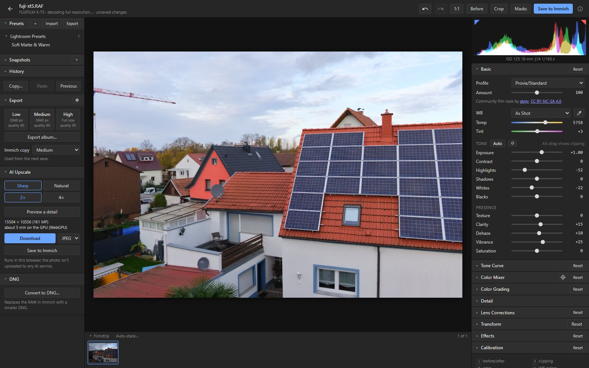

# immich-raw

Lightroom-style RAW editing for [Immich](https://immich.app), right in your browser.

immich-raw adds an **Edit RAW** button to Immich's photo viewer. It opens the RAW file in a full
photo editor. When you save, the edited photo goes back into Immich as a JPEG, stacked on top of the
original. The RAW file itself is never changed, and the edit settings are stored with it, so you can
reopen the photo later and carry on where you left off.

It's an unofficial add-on: a small web app you run next to your own Immich. It isn't affiliated with
Immich or Adobe. Tested with Immich 3.4.0 in Chromium-based browsers (Chrome, Edge); it also works on
phones and tablets.



## Features

Each feature has a guide with screenshots.

- **[Edit from Immich and save back](docs/getting-started.md):** the Edit RAW button, a JPEG of
  your edit stacked on the RAW with its date, location, albums and rating, and the edit kept for
  later.
- **[Lightroom-style editing](docs/editing.md):** white balance, tone, Auto tone, profiles
  (including Fujifilm film looks), curves, Color Mixer, Color Grading, sharpening and noise
  reduction, lens corrections (Lensfun), transform, vignette and grain, crop.
- **[Masks](docs/masks.md):** linear and radial gradients, brush, polygon and lasso, colour and
  luminance ranges, and AI masks: subject, sky, background, people and their parts, landscape,
  objects. Edges can be grown, feathered and smoothed.
- **[Workflow](docs/workflow.md):** histogram, waveform and vectorscope, clipping, before/after,
  zoom to 800 %, history, snapshots, presets, copy and paste, a filmstrip, keyboard shortcuts, and
  [Lightroom import](docs/workflow.md#lightroom-import) of XMP sidecars and presets.
- **[Export](docs/export.md):** JPEG, PNG or TIFF at a size of your choice, with sharpening,
  watermark, metadata and file name settings; one photo, a whole album, or the photos selected in
  Immich.
- **[AI Upscale](docs/upscale.md):** 2× or 4× larger, in the browser, with a preview of a detail.
- **[Stacking and best pick](docs/stacking.md)** (optional culler): bursts and re-takes stacked
  with the best shot in front, the others tagged with why they lost; from the editor or from
  Immich's selection.
- **[Convert to DNG](docs/dng.md):** replace a RAW with a lossless or a much smaller lossy DNG.
- **[Phones and tablets](docs/mobile.md):** a touch layout.

Your photos stay with you: decoding, editing, AI masks and AI Upscale run in your browser, and only
the optional culler looks at photos on your own server ([Under the hood](docs/under-the-hood.md)).

## Try it

A throwaway Immich with immich-raw and five sample RAWs, with nothing but Docker. Start it straight
from the registry (macOS, Linux):

```sh
docker compose -f oci://ghcr.io/lorinmuehlebach/immich-raw-demo up -d
```

Or download its compose file first. Use this on Windows with Docker Desktop, where the `oci://`
command currently fails, and with older Docker Compose versions:

```sh
curl -fsSLO https://raw.githubusercontent.com/LorinMuehlebach/immich-raw/main/deploy/demo/compose.yml
docker compose -f compose.yml up -d
```

In PowerShell, write `curl.exe` instead of `curl`.

Open http://localhost:8088 (or `http://<this computer's address>:8088` on a phone) and log in as
`admin@example.com` / `raw-editor-e2e`. Add `--profile culler` for auto-stacking, with bursts to try
it on. Settings, limits and removing it: [deploy/demo/](deploy/demo/README.md).

## Installation

You need:
- Immich 3.4.x, run with Docker Compose;
- HTTPS or plain HTTP (over HTTPS the browser keeps recently opened RAWs, and AI Upscale can do
  whole photos);
- a browser with WebGL2, and about 2 GB of memory in the tab for the largest RAWs.

**Quick setup:** one container goes in front of Immich, on Immich's port. It serves the editor and
passes everything else to Immich, adding the Edit RAW button on the way.

1. In the `docker-compose.yml` you run Immich with, add the immich-raw service:

   ```yaml
     immich-raw:
       container_name: immich_raw
       image: ghcr.io/lorinmuehlebach/immich-raw:latest
       ports:
         - '2283:80'
       depends_on:
         - immich-server
       restart: always
   ```

2. In the same file, take the port away from `immich-server`: remove or comment out its `ports:` lines.
3. Run `docker compose up -d`.

Port 2283 now leads to immich-raw, which passes everything on to Immich. The
[installation guide](docs/installation.md) covers the rest: reverse proxies, your own nginx or Caddy,
the userscript, the optional culler, updating, building the images and uninstalling.

## Development

`npm install`, `npm run build`, then a throwaway Immich in Docker to test against:
[Development](docs/development.md) has the commands, the tests and the project layout.

## Licence

immich-raw is licensed under the GNU Affero General Public License v3.0 ([LICENSE](LICENSE)).

It includes third-party components such as LibRaw, Little CMS, libjpeg, Svelte, jSquash and the
Lensfun database. They are listed with their licences in
[THIRD-PARTY-NOTICES.md](THIRD-PARTY-NOTICES.md), and the full texts are in [licenses/](licenses/).
The editor links to all of it from the ⓘ button in its header.

This product includes DNG technology under license by Adobe. immich-raw is not affiliated with
Immich, Adobe or LibRaw. The sample photos in the screenshots are from
[raw.pixls.us](https://raw.pixls.us) (CC0).

## How it was made

immich-raw was created using Claude AI tools (Claude Code by Anthropic).
