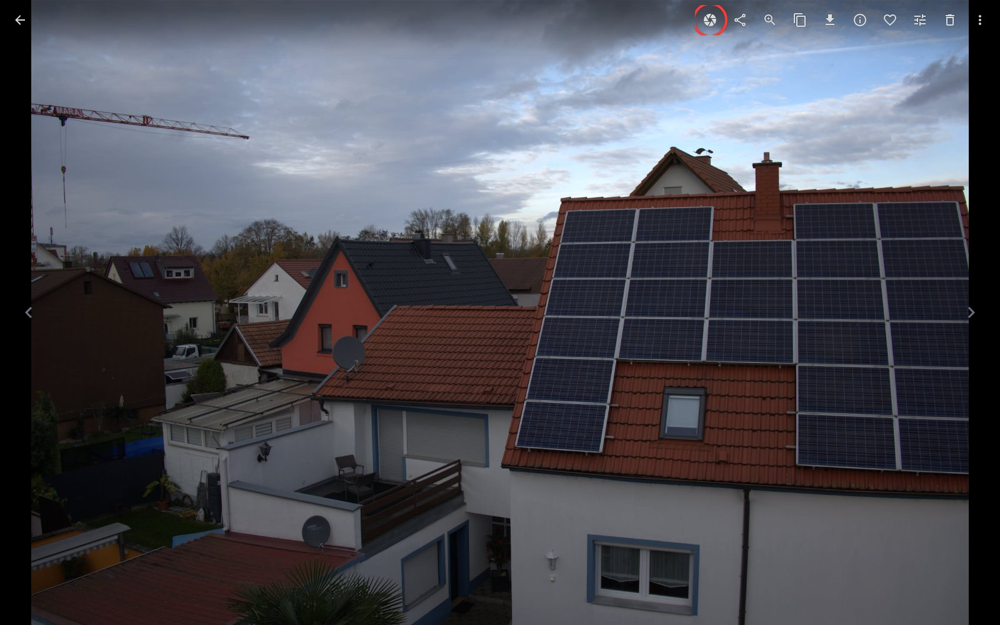
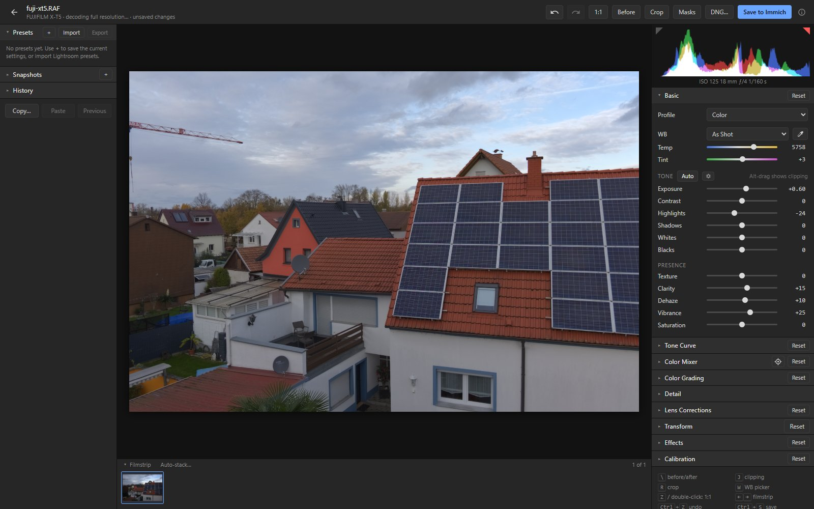
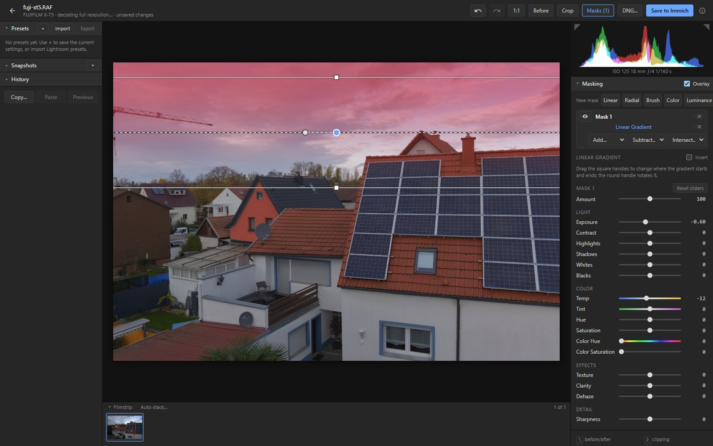
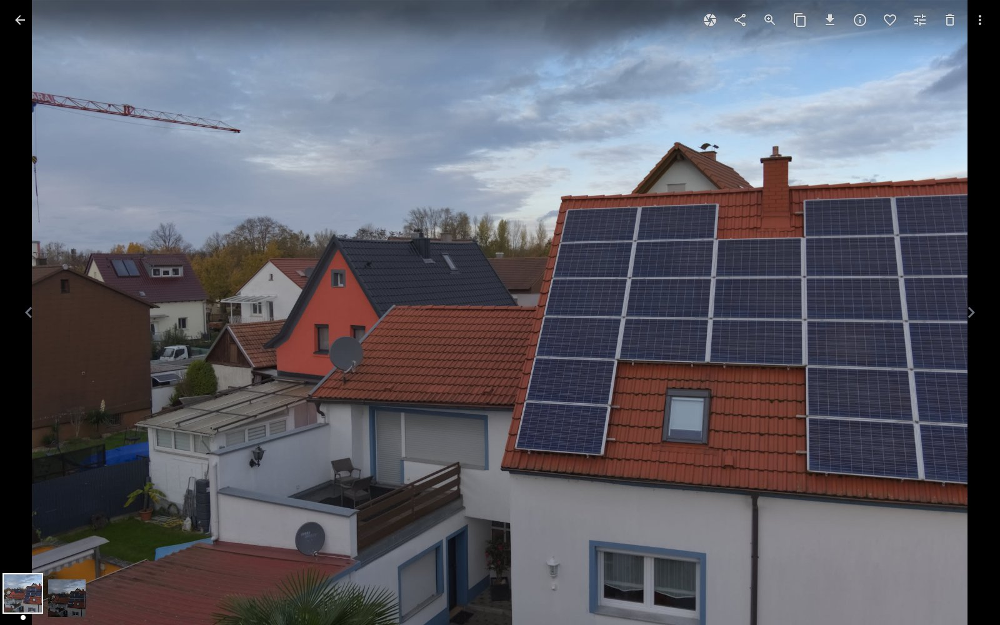
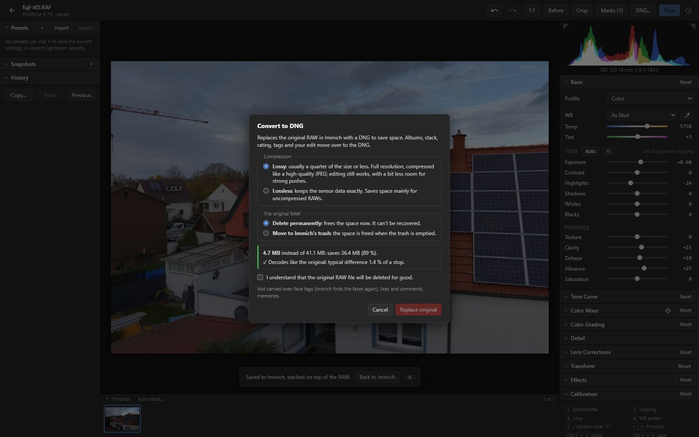

# immich-raw

Lightroom-style RAW editing for [Immich](https://immich.app), right in your browser.

immich-raw adds an **Edit RAW** button to Immich's photo viewer. It opens the RAW file in a full photo
editor: white balance, tone, colour, curves, masks, lens corrections, noise reduction and more. When
you save, the edited photo goes back into Immich as a JPEG, stacked on top of the original. The RAW file itself is never changed, and the edit settings are stored with it, so you can
reopen the photo later and carry on where you left off.

It's an unofficial add-on: a small web app you run next to your own Immich. It isn't affiliated with
Immich or Adobe.

Tested with Immich 3.4.0 in Chromium-based browsers (Chrome, Edge). It also works on phones and
tablets, with a layout made for touch.

## How it works

**1. Open a RAW in Immich and click the iris button** in the viewer's toolbar (outlined in red here).
The button only appears on RAW files, and on edited copies, where it opens the RAW again.



**2. Edit in the browser.** The RAW is decoded on your computer, not on the server, and your graphics
card renders every change live. The panels follow Lightroom's Develop module: Basic, Tone Curve,
Color Mixer, Color Grading, Detail, Lens Corrections, Transform, Effects and Calibration. Lightroom
presets (`.xmp`) and sidecar files can be imported.



**3. Make local adjustments with masks:** linear and radial gradients, a brush, colour and
luminance ranges, and AI masks (subject, sky, background, people, landscape, objects), each with its
own exposure, contrast, colour and sharpness sliders. Here a gradient darkens the sky; the red
overlay shows where it applies.



**4. Save.** The edited JPEG is uploaded to Immich and stacked on top of the RAW. It keeps the
RAW's date, location, albums, rating, description and favourite. The two thumbnails at the bottom
left are the stack: the edited JPEG and the RAW. Saving again replaces the JPEG, and the old one goes
to Immich's trash. Leaving with unsaved changes asks whether to save them.

The JPEG's size, quality and sharpening come from one of the Export presets: Medium (3840 px long
edge) unless you pick another under **Immich copy** in the Export panel. Pick High for full
resolution. A new choice applies from the next save. The copy in Immich is always a JPEG without
watermark and keeps the RAW's own metadata.



**5. Optional: convert to DNG to save space.** The DNG… button replaces the RAW in Immich with a
DNG, either lossless (the exact sensor data) or lossy (Adobe's lossy DNG, typically 7 to 15 times
smaller). Before anything is uploaded, the DNG is decoded again and compared with the original.
Albums, stack, tags, rating, favourite, shared links and your edit all move to the DNG; then the
original is deleted (to the trash, or permanently).



### Under the hood

- **Same address as Immich.** The editor is a static web app served under `/immich-raw/` on your
  Immich address. It uses your existing Immich login and talks to Immich's API
  directly. There is no separate account, and photos aren't processed on the server.
- **RAW decoding:** [LibRaw](https://www.libraw.org) compiled to WebAssembly, running in a background
  worker in the browser.
- **Rendering:** a WebGL2 pipeline in a wide linear colour space. It previews at reduced size while
  you drag a slider and renders full resolution for 100 % zoom and for saving.
- **The buttons:** a small script that the immich-raw container (or your own proxy, or a browser
  userscript) adds to Immich's pages: Edit RAW in the photo viewer, Export in the bar shown while
  photos are selected. To find out which photos are selected (Immich keeps only those on screen in
  the page), the export button presses Immich's download shortcut (Shift+D) and catches the
  request, so nothing is downloaded. Immich then clears its selection, as after a download.
- **Stored data:** the edit settings live in Immich's asset metadata on the RAW. The original file is
  cached in the browser (over HTTPS), so reopening a photo is fast.
- **AI masks:** small models run in a background worker in the browser (ONNX Runtime, with WebGPU
  when the browser has it, and MediaPipe). The first AI mask asks before downloading its models from
  Hugging Face and Google (about 45 to 240 MB each, 316 MB for all kinds); they are then kept in the
  browser. The photo is not uploaded anywhere. Like Lightroom, an edit stores what an AI mask selects
  (Subject, Sky, which People parts), not its pixels: the mask is found again when the photo is
  opened, and on another photo when it is copied or saved in a preset.
- **Culler (optional):** a separate small service that groups bursts of similar shots into stacks,
  puts the best one on top and tags why the others lost (lighting, blur, closed eyes). For RAW files
  it measures exposure on the RAW file itself, because Immich's RAW previews are auto-brightened. See
  [Optional: the culler](#optional-the-culler-auto-stack-and-best-pick) and
  [docs/culler.md](docs/culler.md).

## Features

- **Basic:** profile, white balance (as shot, presets, custom, picker), exposure, contrast, highlights,
  shadows, whites, blacks, texture, clarity, dehaze, vibrance, saturation.
- **Auto tone (Ctrl+U)** sets exposure, contrast, highlights, shadows, whites and blacks for the photo.
  Shift+double-click a slider name to set only that slider. The gear next to Auto sets how it behaves.
- **Tone curve:** parametric and point curves, RGB and per channel.
- **Color Mixer:** hue, saturation and luminance for 8 colour bands, with the targeted adjustment tool
  (drag up or down on a colour in the photo); B&W mix for the Monochrome profile.
- **Color Grading** (shadow, midtone, highlight and global wheels, blending, balance) and
  **Calibration** (shadow tint, red/green/blue primaries).
- **Detail:** sharpening with Alt-drag previews; luminance and colour noise reduction.
- **Lens Corrections:**
  - lens profiles from the [Lensfun](https://lensfun.github.io) database (distortion, chromatic
    aberration, vignetting), or the correction a DNG carries;
  - automatic chromatic aberration removal;
  - manual distortion, defringe and lens vignetting.
- **Transform:** vertical and horizontal perspective, rotate, aspect, scale, offsets, Constrain Crop.
- **Effects:** post-crop vignetting (three styles) and grain.
- **Crop and straighten** with aspect presets; rotate 90°.
- **Masking (Shift+W):**
  - linear (M) and radial (Shift+M) gradients;
  - brush (K; Alt erases, `[` and `]` change the size);
  - colour ranges (click a colour, Shift+click to add one);
  - luminance ranges;
  - AI masks:
    - Subject, Sky and Background;
    - People: everyone or one person; the whole person or any of face skin, body skin,
      eyebrows, eye whites, iris and pupil, lips, teeth, hair, facial hair and clothes;
    - Landscape: sky, water, vegetation, mountains, architecture, natural and artificial ground,
      and snow (snow is found by colour, as the scene model has no snow class);
    - Objects: drag a box around something, or click it (Shift+click adds points).

    The first use of each kind takes a while (see [Under the hood](#under-the-hood)): about 5 to 20
    seconds per photo depending on the computer, a few seconds with WebGPU, and it is remembered
    for the photo.

  Mask parts can be added, subtracted or intersected, and O shows the overlay.
- **Workflow:**
  - histogram with clipping warnings (J), before/after (`\`), 100 % zoom (double-click the photo)
    and free zoom up to 800 % (Ctrl + mouse wheel, or pinch on a trackpad);
  - history with named steps, undo/redo;
  - snapshots (stored on the RAW);
  - presets (kept in the browser; Lightroom `.xmp` presets can be imported);
  - copy/paste settings;
  - a filmstrip of the album, person or search you came from.
- **Export** (left panel): Low (web), Medium (screens) and High (print) download the edit, saved or
  not. The gear sets, for each preset:
  - file type: JPEG, PNG or TIFF (8 bits, sRGB);
  - size: full, long or short edge, width or height (pixels, cm or inches at a resolution), or
    megapixels; never larger than the photo;
  - JPEG quality, output sharpening (screen, matte or glossy paper; low, standard or high);
  - a text watermark (position, size, opacity);
  - metadata: all, all except location, or copyright only, with a copyright line such as
    `© {year} {owner}`;
  - the file name: the original name, with the preset or date, album and number, or your own pattern.

  The settings are kept in the browser. **Export album…** exports every photo of an Immich album with
  one preset: RAWs with their saved edit (or the default settings), other photos at the preset's size
  and type; videos are skipped. A JPEG the editor saved is rendered again from its RAW, so it loses no
  quality; only when that RAW is gone is the JPEG itself exported. The same works for photos selected
  in Immich: select them in the timeline, an album or a search, then click the export icon in
  Immich's selection bar. In Chrome and Edge on HTTPS the files go into a folder you choose, elsewhere
  into one ZIP. Each RAW is rendered in the browser (about 17 seconds of work per photo), several at
  once: 4 on a computer and 2 on a phone or tablet, or what you pick, from 1 to 16. On an 8-core
  laptop, 4 at once was 2.7 to 3.9 times faster than one at a time, and 8 up to 3.5 times faster for
  40 to 65 MP files ([Export speed](docs/export-speed.md), which also covers what HTTPS adds). Wider
  colour spaces, 16-bit files and Content Credentials are [feature requests](docs/feature-requests.md).
- **Lightroom XMP sidecar import** on first open: basic, curves, colour mixer, B&W, colour grading,
  calibration, detail, lens corrections, transform, effects, crop and masks, including AI masks
  (Subject, Sky, Background, People parts, Landscape), which are found again in the photo. AI
  Objects and one person's parts can't be told apart in the file: objects are skipped, and a part
  of one person applies to everyone. Lightroom presets with AI masks (Adaptive presets) work the same.
- **Convert to DNG** (lossless or lossy), described above.
- **Phones and tablets:** a touch layout with the panels in tabs (Edit, Crop, Masks, Presets), below
  the photo when the device is upright and beside it when sideways. Pinch to zoom and pan, double-tap
  a slider to reset it; crop and mask handles are finger-sized. The panel folds away to give the
  photo the whole screen.

The editor shows its keyboard shortcuts in the right-hand panel (on a computer).

## Installation

There are two ways to set it up:

- **Quick setup (recommended):** one container goes in front of Immich, on Immich's port. It serves
  the editor and passes everything else to Immich, adding the Edit RAW button on the way. Your
  reverse proxy, the mobile apps and other clients keep working as before.
- **Advanced setup:** your own reverse proxy sends `/immich-raw/` to the container and adds the
  button itself (nginx or Caddy), or a browser userscript adds it.

A second container, the culler, is optional in both.

### Requirements

- **Immich 3.4.x** (tested with 3.4.0), run with Docker Compose.
- **HTTPS or plain HTTP.** Both work, including a plain `http://192.168.x.x:2283` address. On plain
  HTTP the browser keeps no copy of the originals, so the editor downloads the RAW again each time
  you open it. Over HTTPS (or on `localhost`) it keeps recently opened originals.
- **A browser with WebGL2:** tested in Chrome and Edge. Large RAWs (45–60 megapixels) need about
  2 GB of memory in the browser tab.
- **Phones and tablets** work too (see [Features](#features)), but a phone's browser may not give one
  tab enough memory for the largest RAWs.

The images are published on GitHub's container registry:
- `ghcr.io/lorinmuehlebach/immich-raw` for x86-64 and ARM64;
- `ghcr.io/lorinmuehlebach/immich-raw-culler` for x86-64.

### Quick setup

1. In the `docker-compose.yml` you run Immich with, add the immich-raw service:

   ```yaml
     immich-raw:
       container_name: immich_raw
       image: ghcr.io/lorinmuehlebach/immich-raw:latest
       ports:
         - '2283:80'
       depends_on:
         - immich-server
       restart: always
   ```

2. In the same file, take the port away from `immich-server`: remove or comment out its `ports:` lines.

   ```yaml
     immich-server:
       # ... unchanged ...
       # ports:
       #   - '2283:2283'
   ```

3. Start it:

   ```sh
   docker compose up -d
   ```

Port 2283 now leads to immich-raw, which passes everything on to Immich.
- **Reverse proxies reaching Immich by container name** (for example `http://immich-server:2283`
  on a Docker network, or Traefik labels on `immich-server`) need one change: point them at
  `immich-raw`, port 80.
- **A differently named Immich container:** set `IMMICH_URL` on immich-raw, for example
  `IMMICH_URL: http://my-immich:2283`.

To undo the setup, give the port back to `immich-server` and remove the service.

### Advanced setup: your own reverse proxy

Here immich-raw only serves the editor, and your proxy sends `/immich-raw/` to it. Everything else
goes to Immich as before.

**1. Add the container** to Immich's `docker-compose.yml`, without a port:

```yaml
  immich-raw:
    container_name: immich_raw
    image: ghcr.io/lorinmuehlebach/immich-raw:latest
    restart: always
```

Run `docker compose up -d immich-raw`. The container serves the editor on port 80, and your reverse
proxy reaches it by name. If your proxy runs outside this compose project, put both on the same
Docker network. Or publish a local port (for example `ports: ["127.0.0.1:8090:80"]`) and point the
proxy at `127.0.0.1:8090`.

**2. Route `/immich-raw/` and add the button.** Every path stays with Immich except `/immich-raw/`.
The proxy also adds one script tag (`/immich-raw/inject.js`) to Immich's HTML pages; that script
draws the button.

**nginx.** Add the following to the server block for your Immich domain. The complete example,
including the optional culler, is [deploy/immich-nginx.snippet.conf](deploy/immich-nginx.snippet.conf).

```nginx
# http {} level (a file in conf.d/ is already inside http {}):
# Immich's HTML is fetched uncompressed so the script tag can be added.
map $uri $immich_accept_encoding {
  ~^/(_app|api)/ $http_accept_encoding;
  default "";
}

server {
  # ... your existing listen / server_name / ssl settings for Immich ...
  resolver 127.0.0.11 valid=10s;            # Docker's DNS; remove outside Docker
  set $immich_raw http://immich-raw:80;
  set $immich http://immich-server:2283;

  location /immich-raw/ {
    proxy_pass $immich_raw;
    proxy_set_header Host $host;
  }

  location / {
    proxy_pass $immich;
    # ... your existing Immich proxy settings (websocket upgrade, timeouts, body size) ...
    proxy_set_header Accept-Encoding $immich_accept_encoding;
    sub_filter '</head>' '<script defer src="/immich-raw/inject.js"></script></head>';
    sub_filter_once on;
  }
}
```

**Caddy.** See [deploy/Caddyfile.snippet](deploy/Caddyfile.snippet). Adding the button needs Caddy built
with the `replace-response` plugin (`xcaddy build --with github.com/caddyserver/replace-response`).
Without the plugin, keep only the `/immich-raw/*` route and use the userscript (step 3).

**Traefik and other proxies.** Route the path prefix `/immich-raw/` on your Immich host to the
`immich-raw` container on port 80, then use the userscript for the button (step 3). With Traefik that
means labels like these on the `immich-raw` service (an untested example; adjust the entry point and
TLS settings to your setup):

```yaml
    labels:
      - traefik.enable=true
      - traefik.http.routers.immich-raw.rule=Host(`photos.example.com`) && PathPrefix(`/immich-raw/`)
      - traefik.http.routers.immich-raw.entrypoints=websecure
      - traefik.http.routers.immich-raw.tls=true
      - traefik.http.services.immich-raw.loadbalancer.server.port=80
```

The editor container sends `Cross-Origin-Opener-Policy`, `Cross-Origin-Embedder-Policy` and
`Cross-Origin-Resource-Policy` headers. The editor doesn't need them today, but they are best passed
through as they are.

**3. Only if your proxy can't add the button: the userscript.**

1. Install a userscript extension: [Violentmonkey](https://violentmonkey.github.io) or
   [Tampermonkey](https://www.tampermonkey.net).
2. Open `https://<your-immich>/immich-raw/immich-raw.user.js`; the extension offers to install it.
3. In the extension's editor, change `// @match https://immich.example.com/*` to your Immich address,
   keeping the trailing `/*`, and save.

If both the proxy script and the userscript are active, only one button appears.

### Check

1. Reload Immich and open a RAW photo. The iris button appears at the left of the viewer's toolbar.
2. Click it. The editor opens at `<your-immich>/immich-raw/?asset=…` and shows the photo after a few
   seconds (the first open downloads the RAW).
3. If the button doesn't appear, the script tag isn't being added: check the proxy setup above, or use
   the userscript.

### Optional: the culler (auto-stack and best pick)

The culler groups bursts and similar shots into Immich stacks and puts the best photo of each group
on top. It tags the others with the reason they lost: lighting, blur or closed eyes. It works on
RAWs, JPEGs and RAW + JPEG pairs. It sorts new uploads automatically, and you can run it on a day or
an album from the editor's filmstrip (**Auto-stack…**), with a preview first and undo afterwards.

It runs small AI models (CLIP, YuNet, MediaPipe) on the server's CPU; they are part of the image,
which is about a 1.8 GB download. How it decides, all settings and the command line are in
[docs/culler.md](docs/culler.md).

1. In Immich, create an API key for the user whose library it should sort: **Account Settings → API
   Keys**. It needs these permissions:
   - `asset.read`, `asset.view`, `asset.download`, `asset.update`
   - `album.read`, `user.read`
   - `stack.create`, `stack.read`, `stack.update`, `stack.delete`
   - `tag.create`, `tag.read`, `tag.asset`

   Put the key in a file `culler.env` next to your compose file, and keep that file private:

   ```sh
   IMMICH_API_KEY=your-key-here
   ```

2. Add the service to the compose file:

   ```yaml
     immich-culler:
       container_name: immich_culler
       image: ghcr.io/lorinmuehlebach/immich-raw-culler:latest
       env_file: culler.env
       environment:
         IMMICH_URL: http://immich-server:2283
         # CULLER_WATCH: "false"        # don't sort new uploads automatically
         # CULLER_AUTO_APPLY: "false"   # only suggest (dry runs) for new uploads
       volumes:
         - culler-data:/data
       cpus: 2
       mem_limit: 2g
       restart: always

   volumes:
     culler-data:
   ```

3. Quick setup: nothing else to do. The immich-raw container finds the culler at `immich-culler:8080`
   (set `CULLER_URL` on immich-raw if you name it differently). Advanced setup: route
   `/immich-raw/culler/` to `immich-culler:8080` in your proxy, before the `/immich-raw/` route; the
   nginx and Caddy snippets in [deploy/](deploy/) already contain it.
4. Run `docker compose up -d immich-culler`.

Without the culler, the editor simply hides its controls.
- **New uploads:** on its first start, the culler only sorts photos uploaded from then on. Sort older
  days or albums from the editor.
- **Tags:** the losers get tags under `Culling/` (for example `Culling/Rejected/Blur`).
- **Reject flag:** the culler also sets it (rating −1), but Immich 3.4 empties it again a moment
  later, so the tags are what to search for.
- **Settings:** thresholds and the tag name can be changed in `/data/culler.toml`; see
  [docs/culler.md](docs/culler.md#settings).

### Updating

```sh
docker compose pull immich-raw immich-culler     # leave out immich-culler if you don't use it
docker compose up -d
```

`latest` follows the main branch. To stay on a release, use its version as the tag (for example
`ghcr.io/lorinmuehlebach/immich-raw:1.0.0`) once releases are published.

### Building the images yourself

Clone the repository next to your compose file:

```sh
git clone https://github.com/LorinMuehlebach/immich-raw.git
```

Then replace each `image:` line with a build section:

```yaml
  immich-raw:
    build:
      context: ./immich-raw
      dockerfile: deploy/Dockerfile
  immich-culler:
    build:
      context: ./immich-raw/services/culler
```

Finally run `docker compose up -d --build`. To update, run `git pull` in `immich-raw` and the same
command again.

### Uninstalling

Remove the services (quick setup: give port 2283 back to `immich-server`), or remove the proxy lines
(advanced setup). Edited JPEGs stay in Immich as normal photos, and the RAW files were never changed.
The stored edit settings (asset metadata keys starting with `raw-editor.`) stay behind; Immich
ignores them.

## Development

Everything runs locally against a throwaway Immich in Docker:

```sh
npm install
npm run build                                          # builds the button script and the editor
docker compose -f e2e/docker-compose.immich.yml up -d  # test Immich on http://127.0.0.1:8088
node spikes/decode-bench/fetch-samples.mjs <folder>    # five CC0 sample RAWs (~320 MB)
node e2e/seed.mjs <folder>                             # uploads them
```

Open http://127.0.0.1:8088 and log in with `admin@example.com` / `raw-editor-e2e`. `npm run dev` starts
the editor with hot reload on http://localhost:5173/immich-raw/, using the test Immich's API.

- `npm test`: unit tests (vitest); `npm run check`: type checks.
- `node e2e/smoke.mjs <out-dir>`: end-to-end test (open, edit, save, export, reopen, re-save).
- `node e2e/probe-ai-masks.mjs <out-dir> <asset-id>`: the AI masks on one photo, then an export
  (needs internet for the models).
- `node e2e/export.mjs <out-dir>`: the export options (PNG, TIFF, print size, file names), an album
  export as a ZIP (two photos at once), the export button for photos selected in Immich (including
  select all), and a saved edit exported from its RAW.
- `node e2e/bench-export.mjs <out-dir> [mixed|xt30] [1,2,4,8,16]`: times the batch export at several
  photos at once and samples the browser's memory ([Export speed](docs/export-speed.md)).
- `node e2e/screenshots.mjs`: regenerates the screenshots in this README.
- Culler:
  - `cd services/culler && uv run pytest`: its unit tests;
  - `node e2e/culler-up.mjs`: starts it next to the test Immich;
  - `node e2e/cull.mjs <out-dir>`: its end-to-end test, on RAW and JPEG bursts.
- [e2e/README.md](e2e/README.md) describes the test setup; [deploy/README.md](deploy/README.md) the
  deployment files.

Project layout:

- `apps/editor/`: the Svelte editor.
- `packages/`:
  - `ai`: AI masks (the models, the worker that runs them, turning their output into masks);
  - `decoder`: RAW decoding with LibRaw;
  - `libraw`: LibRaw for WebAssembly (libraw-wasm built without threads, see its README);
  - `pipeline`: WebGL2 renderer, colour maths;
  - `recipe`: edit settings;
  - `xmp`: Lightroom import/export;
  - `lens`: Lensfun profiles, DNG lens data, CA measurement;
  - `dng`: DNG writer;
  - `inject`: the Immich button.
- `services/culler/`: the optional culler (Python).
- `deploy/`: Dockerfile and reverse-proxy snippets.
- `e2e/`: test Immich, seed, smoke-test and screenshot scripts.
- `licenses/`: third-party licence texts.
- `spikes/`, `docs/`: early experiments and measurements.

## Licence

immich-raw is licensed under the GNU Affero General Public License v3.0 ([LICENSE](LICENSE)).

It includes third-party components such as LibRaw, Little CMS, libjpeg, Svelte, jSquash and the
Lensfun database. They are listed with their licences in
[THIRD-PARTY-NOTICES.md](THIRD-PARTY-NOTICES.md), and the full texts are in [licenses/](licenses/).
The editor links to all of it from the ⓘ button in its header.

This product includes DNG technology under license by Adobe. immich-raw is not affiliated with
Immich, Adobe or LibRaw. The sample photo in the screenshots is from [raw.pixls.us](https://raw.pixls.us)
(CC0).

## How it was made

immich-raw was created using Claude AI tools (Claude Code by Anthropic).
