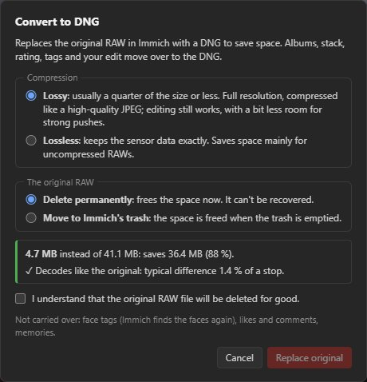

# Convert to DNG

**Convert to DNG…** at the bottom of the left panel replaces the RAW in Immich with a DNG, to save
space:
- **lossless:** the exact sensor data;
- **lossy:** Adobe's lossy DNG, typically 7 to 15 times smaller.

Before anything is uploaded, the DNG is decoded again and compared with the original. Albums, stack,
tags, rating, favourite, shared links and your edit all move to the DNG; then the original is
deleted (to the trash, or permanently).

This product includes DNG technology under license by Adobe.
