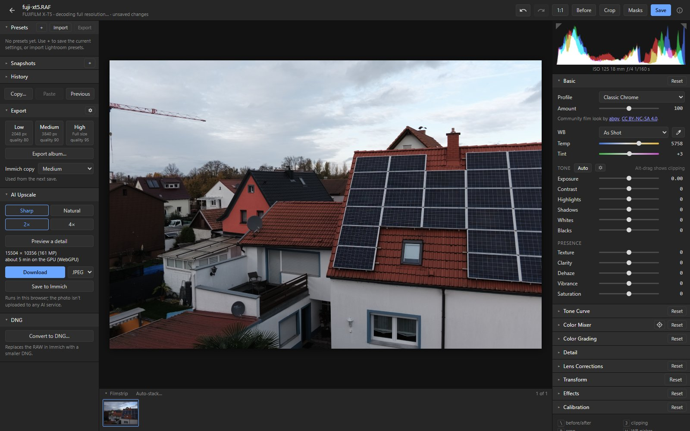
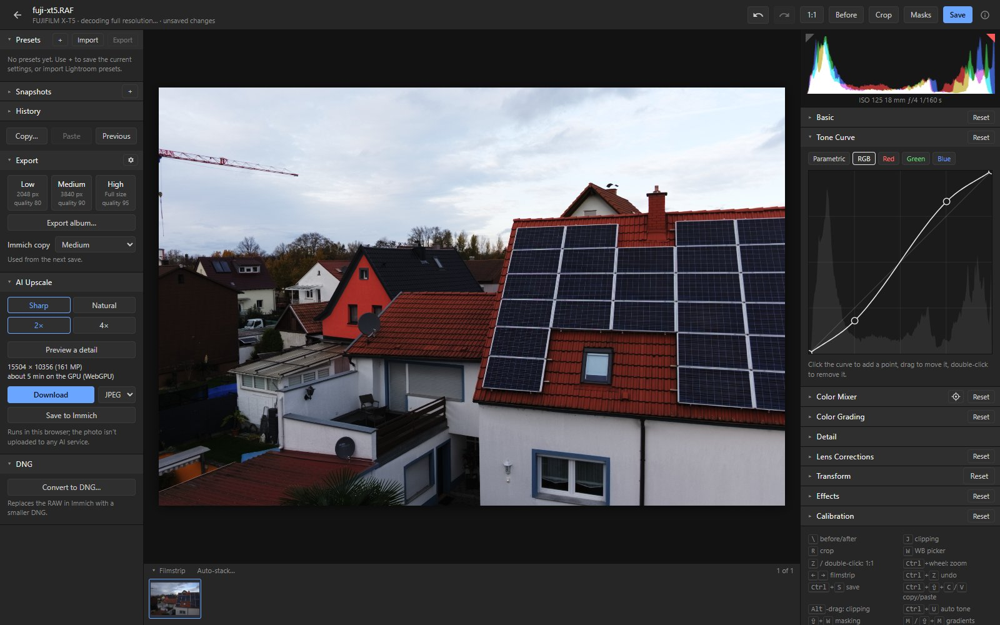
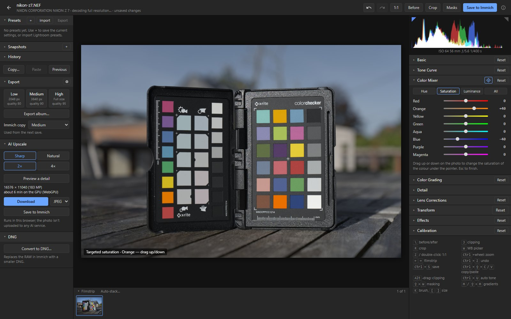
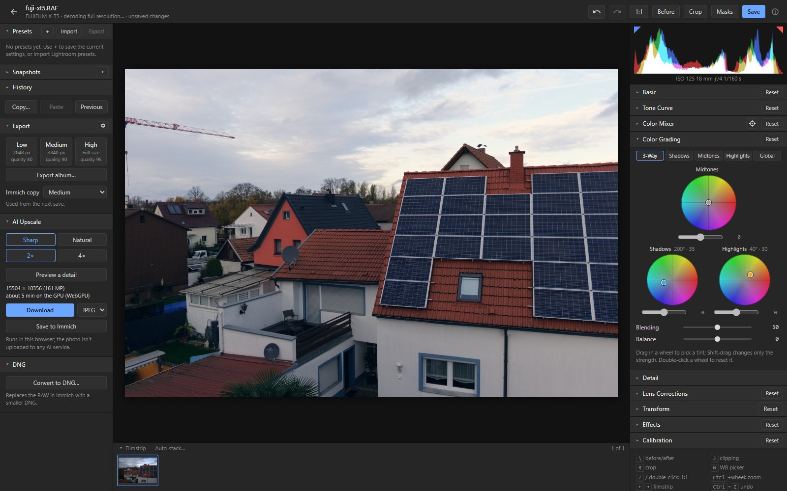
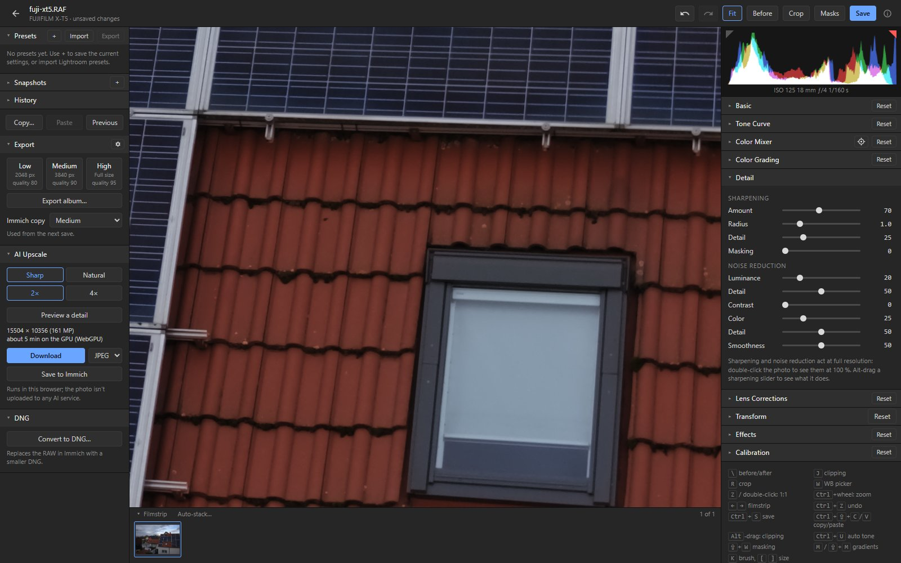
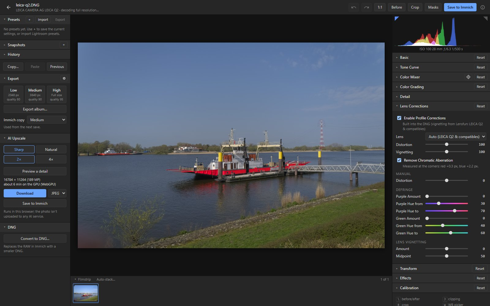
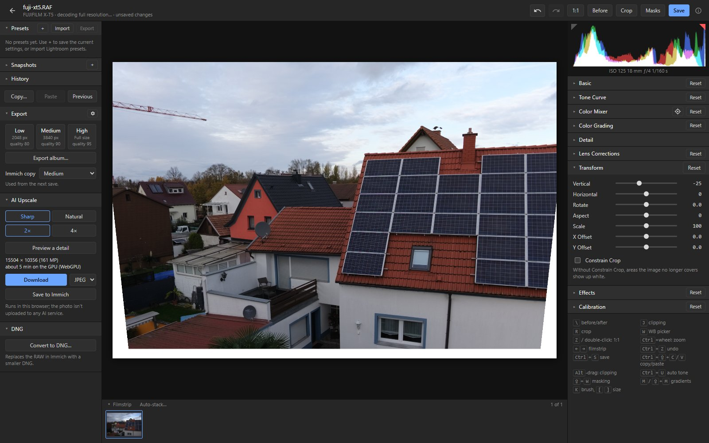
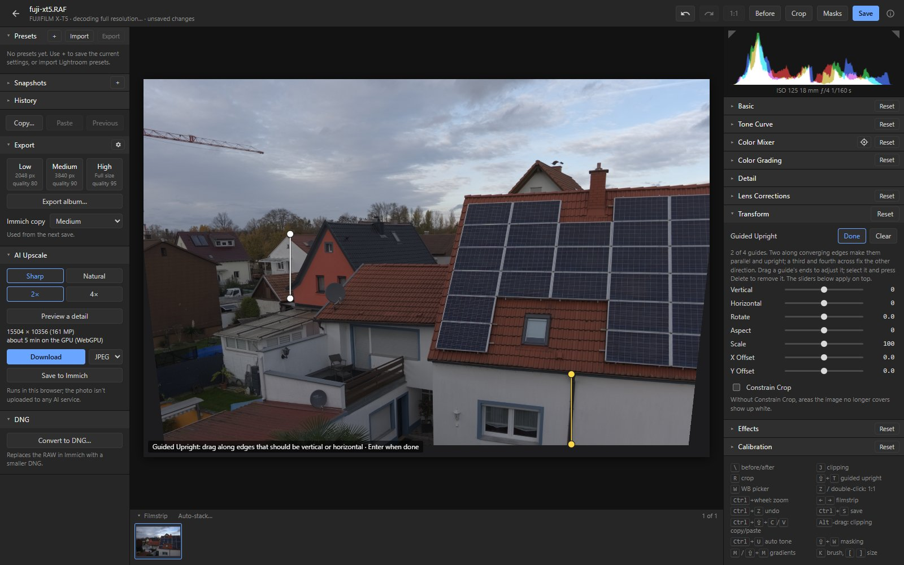
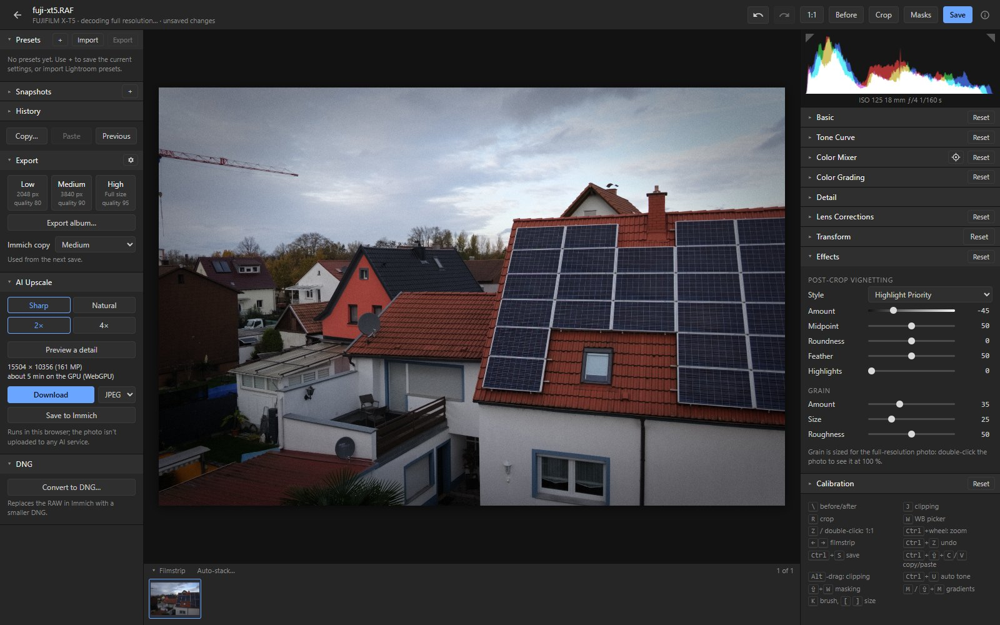
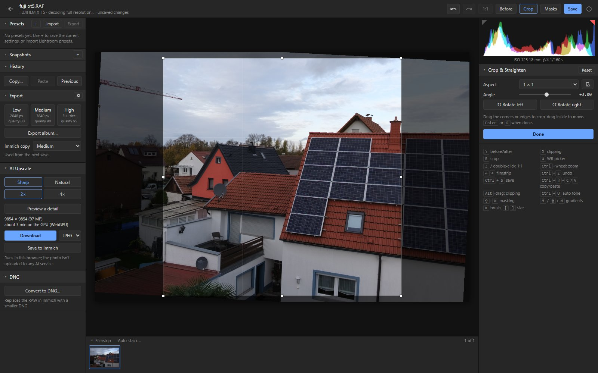

# Editing

The right-hand panels follow Lightroom's Develop module. Click a panel's name to open or close
it; double-click a slider's name to reset it.

## Basic

Profile, white balance (as shot, presets, custom, or the picker: W, then click something neutral
in the photo), exposure, contrast, highlights, shadows, whites, blacks, texture, clarity, dehaze,
vibrance and saturation.

**Auto tone (Ctrl+U)** sets exposure, contrast, highlights, shadows, whites and blacks for the
photo. Shift+double-click a slider name to set only that slider. The gear next to Auto sets how it
behaves.

The editor with Basic open is on [Getting started](getting-started.md#2-edit-in-the-browser).

## Profiles

Color, Vivid, Portrait, Landscape, Neutral, Monochrome and Linear, plus the Fujifilm film looks
(Provia, Velvia, Astia, Classic Chrome, Reala Ace, Pro Neg. Hi and Std, Classic Neg., Nostalgic
Neg., Eterna, Eterna Bleach Bypass) for photos from any camera.
- Vivid, Portrait, Landscape and the film looks have an Amount slider (0 to 200 %).
- A Fujifilm RAW opens with the film simulation it was shot with. Acros and the other monochrome
  simulations open as Monochrome, with a B&W mix for the red, yellow or green filter.
- Lightroom's names for these profiles ("Adobe Vivid", "Camera CLASSIC CHROME") are recognised when
  importing presets and sidecars.

### Fujifilm film looks

The looks are community look tables by
[abpy](https://github.com/abpy/FujifilmCameraProfiles) (CC BY-NC-SA 4.0), modelled on the
camera-matching profiles for Fujifilm X cameras. They are not part of immich-raw: the editor asks
before downloading them from GitHub (about 15 MB, once) and keeps them in the browser. A Fujifilm
RAW offers the download when it opens; without it, the photo shows with Color.

The looks are DNG profile tables (hue, saturation and value changes plus a tone curve) applied
after the editor's own camera colour, so very saturated colours can differ a little from
Lightroom's camera-matching profiles.

## Tone Curve

Parametric and point curves, RGB and per channel.

## Color Mixer

Hue, saturation and luminance for 8 colour bands. With the targeted adjustment tool (the target
icon), drag up or down on a colour in the photo. With the Monochrome profile it becomes the B&W mix.

## Color Grading and Calibration

**Color Grading:** shadow, midtone, highlight and global wheels, blending and balance.
**Calibration:** shadow tint and the red, green and blue primaries.

## Detail

Sharpening, with Alt-drag previews of its sliders, and luminance and colour noise reduction. Look at
it at 100 % (double-click the photo, or Z).

## Lens Corrections

- Lens profiles from the [Lensfun](https://lensfun.github.io) database (distortion, chromatic
  aberration, vignetting), or the correction a DNG carries.
- Automatic chromatic aberration removal.
- Manual distortion, defringe and lens vignetting.

## Transform

Vertical and horizontal perspective, rotate, aspect, scale, offsets and Constrain Crop.

**Guided Upright** (Shift+T, or **Draw guides** in the Transform panel): drag along edges that
should be vertical or horizontal, such as the sides of a building, up to four guides. The photo
straightens when you let go:
- one guide turns it like Straighten;
- two along converging edges make them parallel and upright;
- a third and fourth across fix the other direction as well.

Drag a guide's ends to adjust it; click it and press Delete to remove it; Enter or **Done** when
finished. The sliders apply on top, Constrain Crop keeps the crop inside the straightened photo, and
the guides stay on the photo when it is cropped or turned. The correction assumes the lens's focal
length (from the photo, 35 mm-equivalent); with two guides each way it is measured from the guides
instead. If the result looks squashed or stretched, Aspect corrects it.

## Effects

Post-crop vignetting (three styles) and grain.

## Crop and straighten

R opens the crop tool: aspect presets (X swaps the orientation), the angle, and rotating by 90°
(Ctrl+[ and Ctrl+]). Enter or R closes it.

## Next

- [Masks](masks.md): apply most of these to part of the photo.
- [Workflow](workflow.md): before/after, history, presets and copying settings to other photos.
