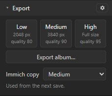
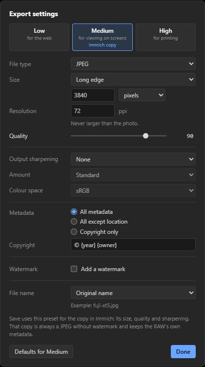
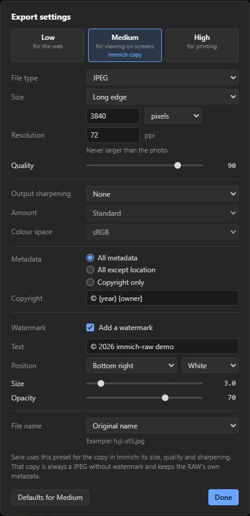
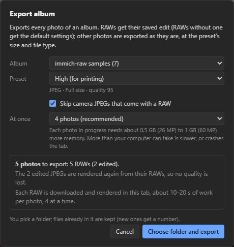
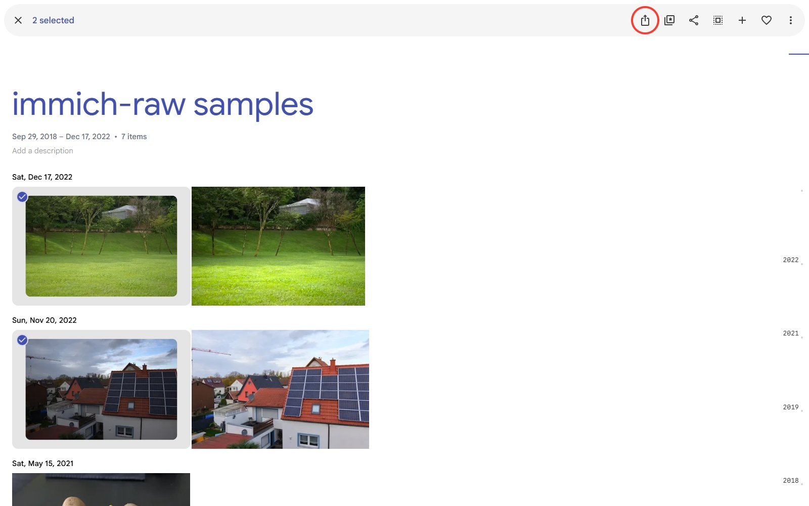
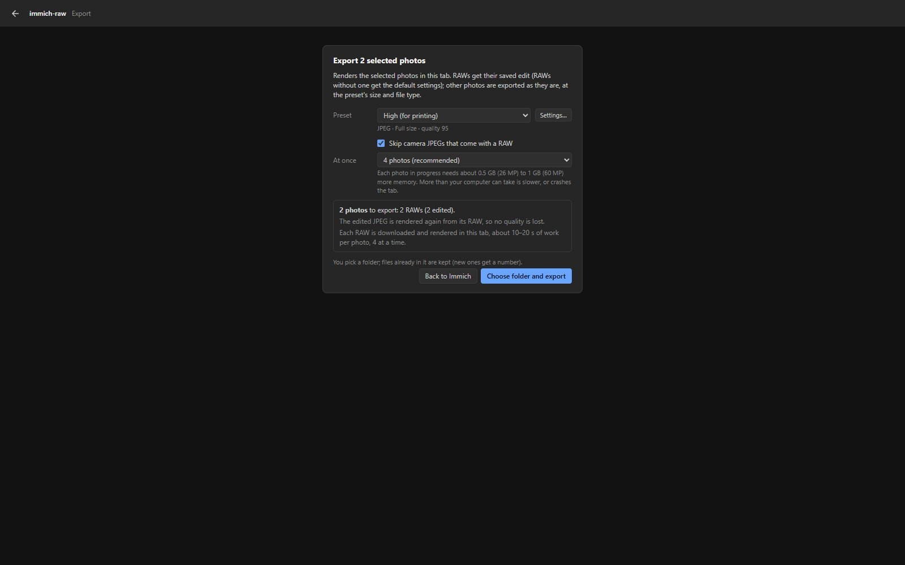

# Export

Export makes files of your edit, saved or not, for the web, screens or print: one photo from the
editor, a whole album, or the photos selected in Immich.

## One photo

**Low** (web), **Medium** (screens) and **High** (print) in the left panel download the edit.

## Settings

The gear sets, for each preset:
- file type: JPEG, PNG or TIFF (8 bits, sRGB);
- size: full, long or short edge, width or height (pixels, cm or inches at a resolution), or
  megapixels; never larger than the photo;
- JPEG quality, output sharpening (screen, matte or glossy paper; low, standard or high);
- a text watermark (position, size, opacity);
- metadata: all, all except location, or copyright only, with a copyright line such as
  `© {year} {owner}`;
- the file name: the original name, with the preset or date, album and number, or your own pattern.

The settings are kept in the browser. One of the presets also makes the copy that **Save to
Immich** uploads (**Immich copy**, see [Getting started](getting-started.md#3-save)).

## A whole album

**Export album…** exports every photo of an Immich album with one preset:
- RAWs with their saved edit (or the default settings);
- other photos at the preset's size and type; videos are skipped;
- a JPEG the editor saved is rendered again from its RAW, so it loses no quality. Only when that RAW
  is gone is the JPEG itself exported.

In Chrome and Edge on HTTPS the files go into a folder you choose, elsewhere into one ZIP.

## Photos selected in Immich

Select photos in the timeline, an album or a search, then click the export icon in Immich's
selection bar (outlined in red here). A page opens with the same choices as Export album.

## Speed

Each RAW is rendered in the browser (about 17 seconds of work per photo), several at once: 4 on a
computer and 2 on a phone or tablet, or what you pick, from 1 to 16. On an 8-core laptop, 4 at once
was 2.7 to 3.9 times faster than one at a time, and 8 up to 3.5 times faster for 40 to 65 MP files.
Measurements, and what HTTPS adds: [Export speed](export-speed.md).

Wider colour spaces, 16-bit files and Content Credentials are
[feature requests](feature-requests.md).
