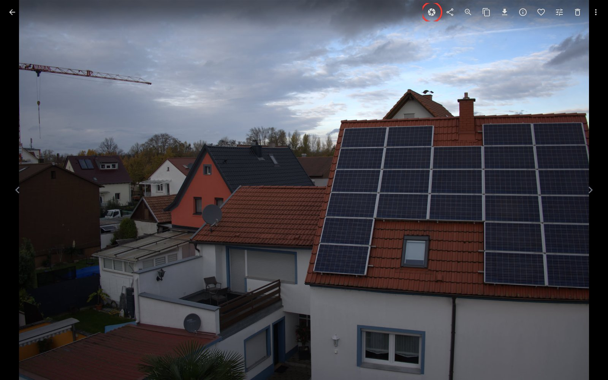
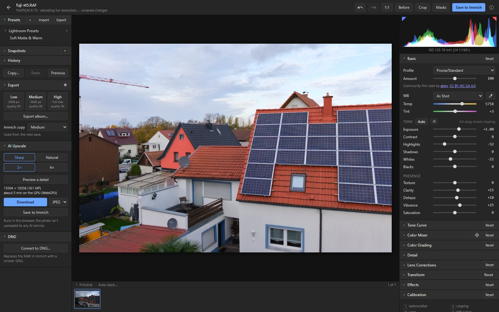
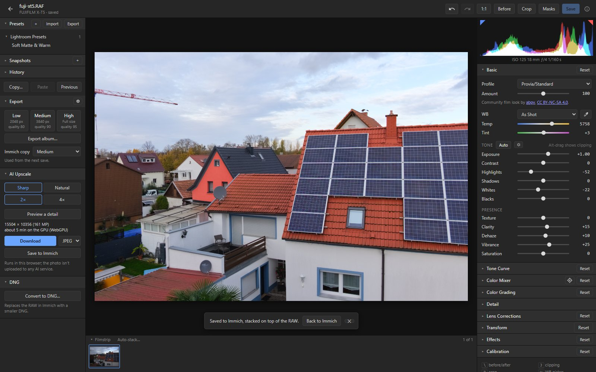
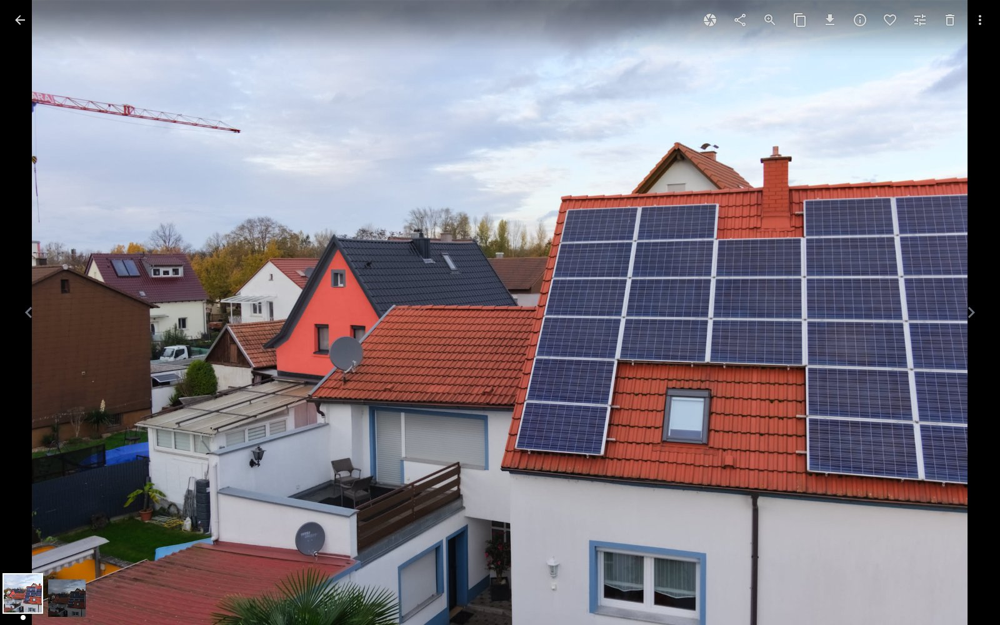

# Getting started: from Immich to the editor and back

immich-raw adds an **Edit RAW** button to Immich. The RAW opens in the editor in your browser, and
your edit goes back into Immich as a JPEG next to the RAW.

## 1. Open a RAW in Immich and click the iris button

The button is in the photo viewer's toolbar (outlined in red here). It only appears on RAW files,
and on edited copies, where it opens the RAW again.

## 2. Edit in the browser

The RAW is decoded on your computer, not on the server, and your graphics card renders every
change live. While it opens, a picture of the photo stands in for it: how it looked in the editor
last time, or Immich's preview. When opening takes
more than a second, the editor lists what it is doing (downloading the original, decoding it,
rendering) and how long that should take; a photo opened before comes from the browser's cache
and skips most of it. The panels follow Lightroom's Develop module: Basic, Tone Curve, Color Mixer, Color
Grading, Detail, Lens Corrections, Transform, Effects and Calibration
([Editing](editing.md)). On the left are presets, snapshots, history, export, AI Upscale and Convert
to DNG; below the photo is the filmstrip.

## 3. Save

**Save to Immich** (Ctrl+S) uploads the edited JPEG and stacks it on top of the RAW.
- It keeps the RAW's date, location, albums, tags, rating, description and favourite.
- Saving again replaces the JPEG; the old one goes to Immich's trash.
- For several versions of one photo, each with its own JPEG, make
  [virtual copies](workflow.md#virtual-copies).
- The RAW file itself is never changed. The edit settings are stored on the RAW in Immich's
  database, so you can reopen the photo later and carry on where you left off.

Two choices under **Save to Immich** in the Export settings (the gear in the Export panel) change
this:
- **In front of the stack:** the edited JPEG (the default) or the RAW. With the RAW in front, the
  JPEG goes in the stack behind it. In a stack of several shots, the best shot stays in front
  either way ([Stacking](stacking.md)).
- **Favourite:** the edited JPEG is a favourite when the RAW is one (the default), or always.

The JPEG's size, quality and sharpening come from one of the [Export](export.md) presets: Medium
(3840 px long edge) unless you pick another under **Immich copy** in the Export panel. Pick High for
full resolution. A new choice applies from the next save. The copy in Immich is always a JPEG
without watermark and keeps the RAW's own metadata.

Unsaved changes don't hold you up while you edit: going to another photo keeps them as a draft.
The title line says "unsaved changes" (with **Discard** to go back to the saved edit), the
filmstrip marks the photo with a blue dot, and the photo opens with its draft again. Going back to
Immich with drafts asks whether to save them, since they only live while the editor is open. See
[Workflow → Drafts](workflow.md#drafts).

## 4. Back in Immich

The edited photo is on top of its stack (unless Save keeps the RAW in front). The two thumbnails at
the bottom left are the stack: the edited JPEG and the RAW. Immich's own Edit RAW button on the JPEG
opens the RAW again.

## Next

- [Editing](editing.md), [Masks](masks.md), [Workflow](workflow.md): what the editor can do.
- [Export](export.md), [AI Upscale](upscale.md), [Convert to DNG](dng.md): what you can make from
  an edit.
- [Stacking and best pick](stacking.md): sorting bursts, with the optional culler.
