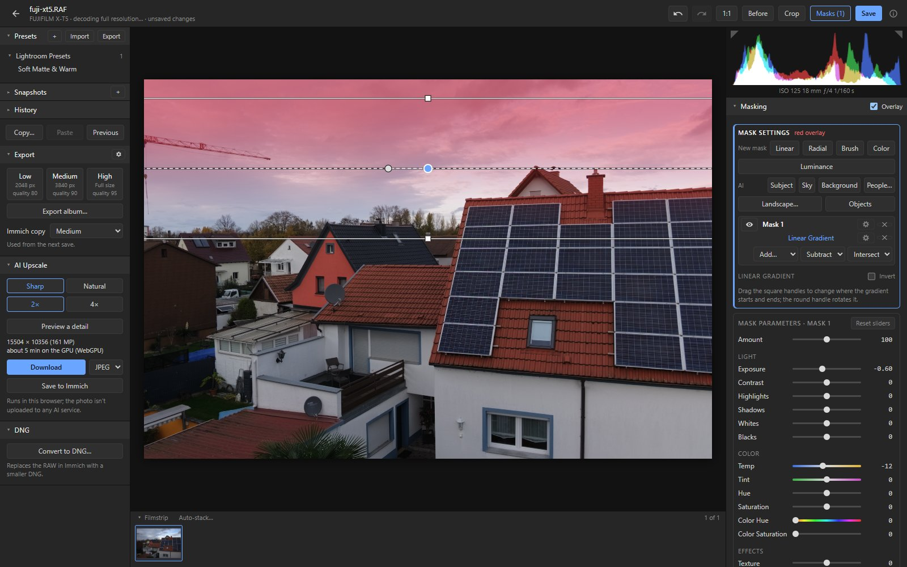
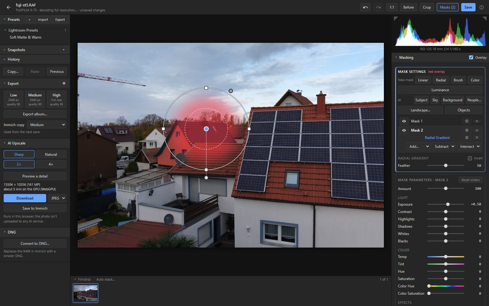
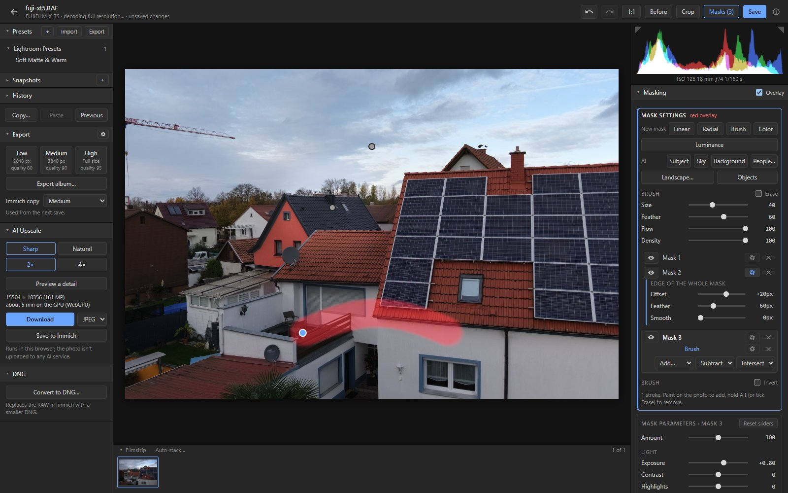
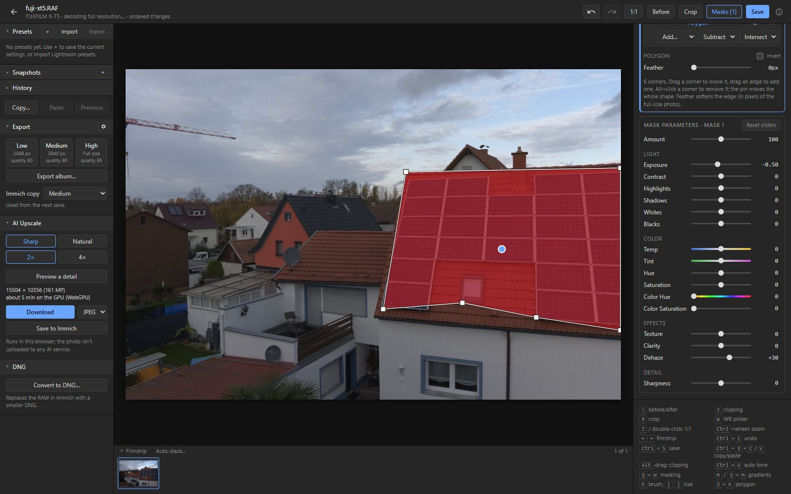
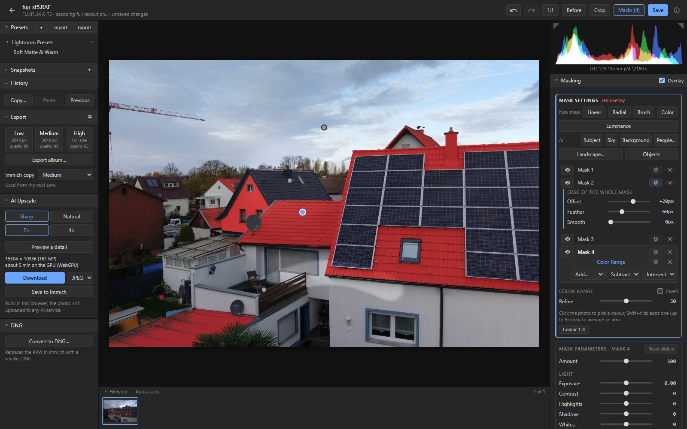
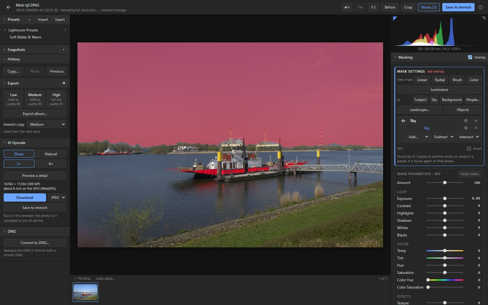
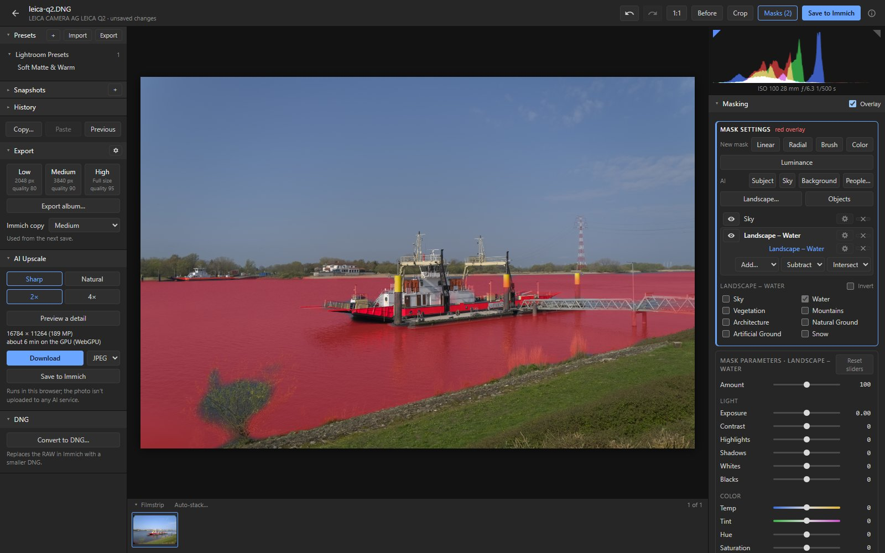
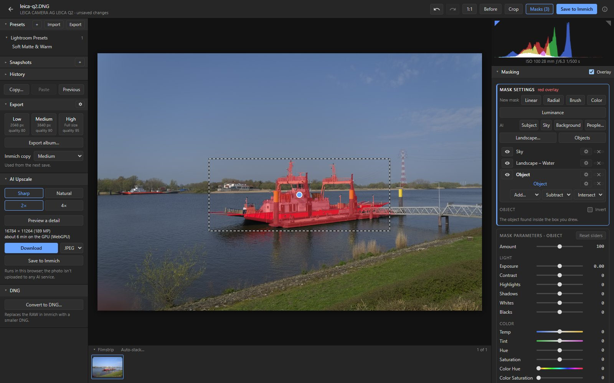
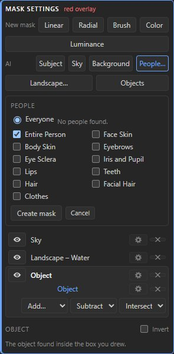
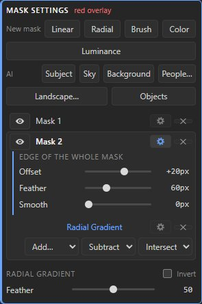

# Masks

Masks apply exposure, contrast, colour, sharpness and the other local sliders to part of the photo.
**Masks** in the header (Shift+W) opens the mask panel. The red overlay shows where a mask applies.

## Gradients, brush, polygons and ranges

- **Linear gradient (M):** drag across the photo. Here it darkens and cools the sky.
- **Radial gradient (Shift+M):** drag out an ellipse; its handles move, resize and turn it.
- **Brush (K):** paint the mask. Alt erases, `[` and `]` change the size; Size, Feather, Flow and
  Density are in the panel.
- **Polygon (Shift+K):** click the corners of the area. Click the first corner, double-click or
  press Enter to close it; Backspace takes back a corner. Then drag a corner to move it, drag an
  edge to add one, Alt+click a corner to remove it, or drag the pin to move the whole shape.
  Its edge is sharp: Feather in the panel softens it.
- **Lasso:** drag around the area; the shape closes when you let go.
- **Color range:** click a colour in the photo, Shift+click to add another.
- **Luminance range:** the bright or dark parts, with "Range from", "Range to" and Smoothness.

## AI masks

AI finds the part of the photo for you:
- **Subject, Sky and Background**;
- **People:** everyone or one person; the whole person or any of face skin, body skin, eyebrows,
  eye whites, iris and pupil, lips, teeth, hair, facial hair and clothes;
- **Landscape:** sky, water, vegetation, mountains, architecture, natural and artificial ground,
  and snow (snow is found by colour, as the scene model has no snow class);
- **Objects:** drag a box around something, or click it (Shift+click adds points).

The first use of each kind takes a while, because its model has to be downloaded first (see
[below](#how-ai-masks-work)). After that a mask takes about 5 to 20 seconds per photo depending on
the computer, a few seconds with WebGPU, and it is remembered for the photo.

## Combining parts and refining edges

A mask can have several parts: **Add**, **Subtract** or **Intersect** another one (a gradient,
the brush, a polygon or lasso, a range or an AI part).

The gear next to each part, and next to the mask itself, opens its edge settings, in pixels of the
full-size photo:
- **Offset** grows or shrinks it;
- **Feather** fades its edge;
- **Smooth** irons out wiggles and specks (which also makes a soft gradient crisp).

Each part's edge is refined before the parts are combined, the whole mask's after.

## The overlay

The panel has two areas. The mask settings (parts, edges) show the red overlay; the mask parameters
(Amount, Exposure…) hide it, so you see the result. A click anywhere in an area switches to it.
O brings the overlay back or switches it off.

## Lightroom

Masks from Lightroom sidecars and presets are imported, AI masks included (they are found again in
the photo): see [Lightroom import](workflow.md#lightroom-import). Lightroom has no edge settings, so
imported masks start without them. It has no polygon or lasso mask either.

## How AI masks work

Small models run in a background worker in the browser: ONNX Runtime (with WebGPU when the browser
has it) and MediaPipe.
- The first AI mask asks before downloading its models from Hugging Face and Google (about 45 to
  240 MB each, 316 MB for all kinds). They are then kept in the browser.
- The photo is not uploaded anywhere.
- Like Lightroom, an edit stores what an AI mask selects (Subject, Sky, which People parts), not its
  pixels. The mask is found again when the photo is opened, and on another photo when it is copied
  or saved in a preset.
- How the models were chosen:
  [docs/spike-results.md](spike-results.md#ai-masks-model-choice-2026-11-11).
