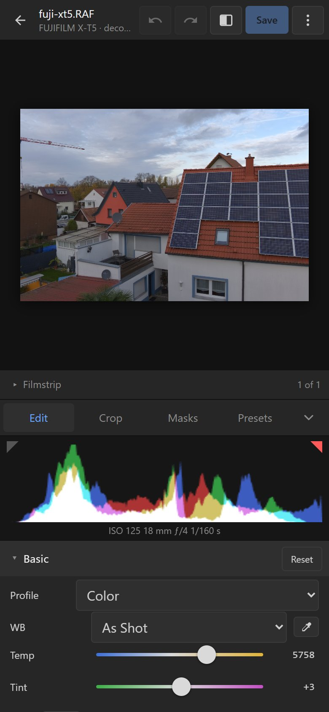
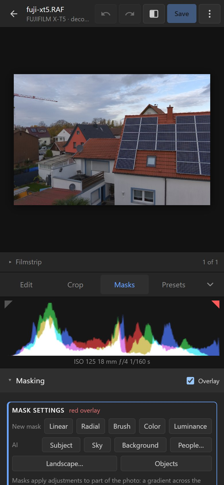
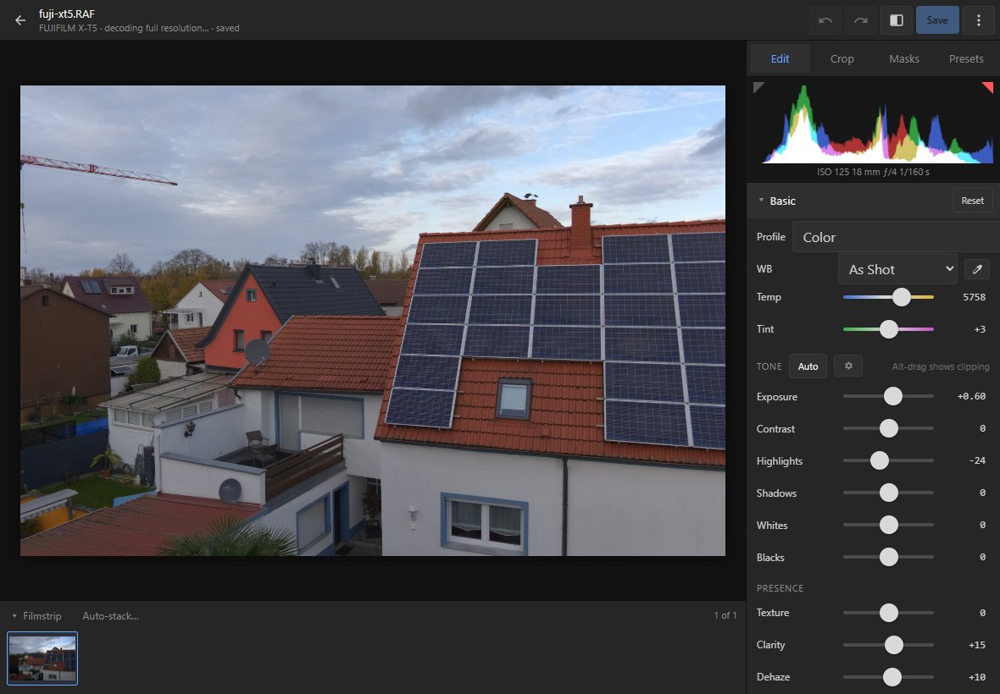

# Phones and tablets

The editor has a touch layout for phones and tablets:
- the panels are in tabs: **Edit**, **Crop**, **Masks** and **Presets** (presets, snapshots,
  history, copy and paste, export, AI Upscale and DNG);
- below the photo when the device is upright, beside it when sideways;
- pinch to zoom and pan, double-tap a slider to reset it; crop and mask handles are finger-sized;
- the panel folds away to give the photo the whole screen.

A phone's browser may not give one tab enough memory for the largest RAWs (45–60 megapixels need
about 2 GB). On plain HTTP the editor downloads the RAW again on every open, and AI Upscale handles
crops only ([Installation → Requirements](installation.md#requirements)).
