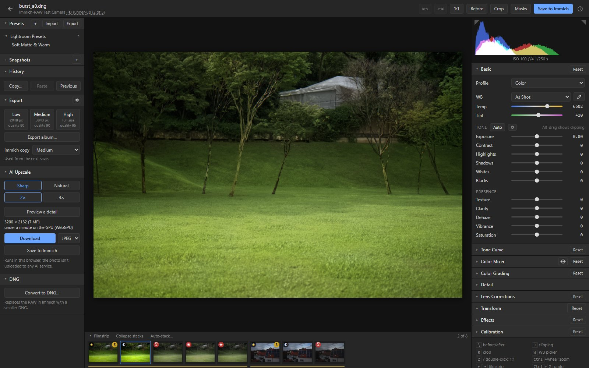
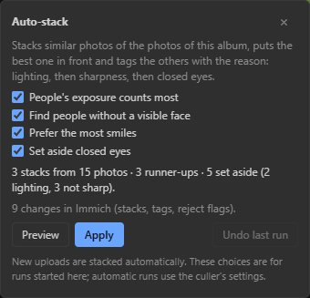
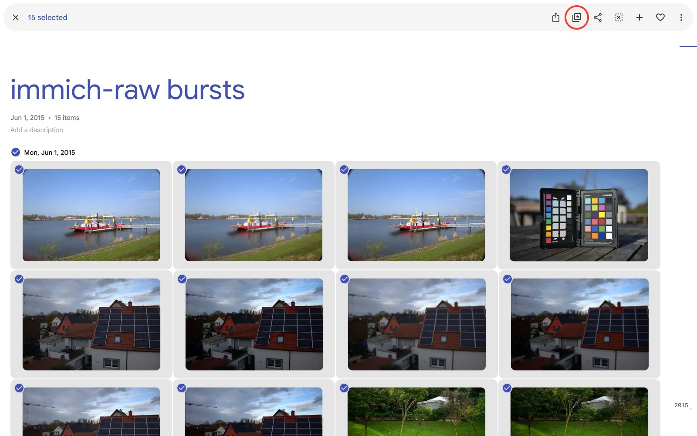
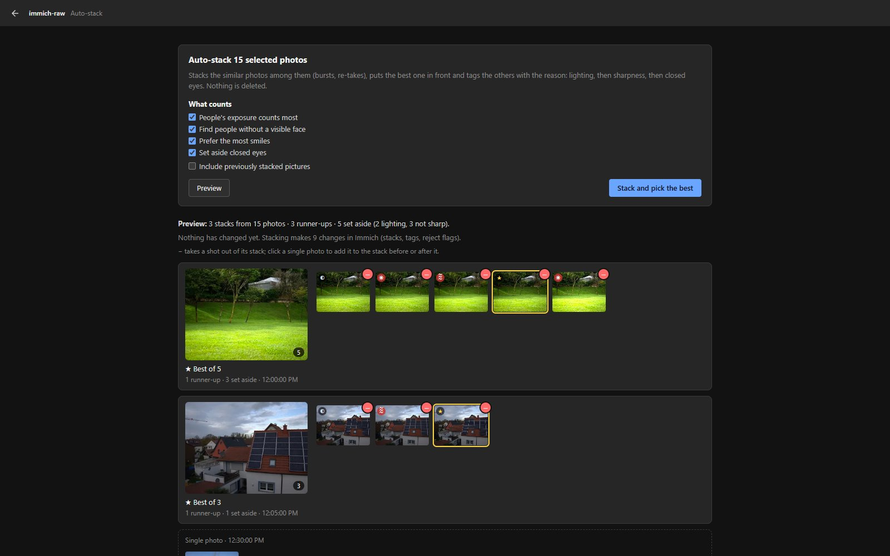
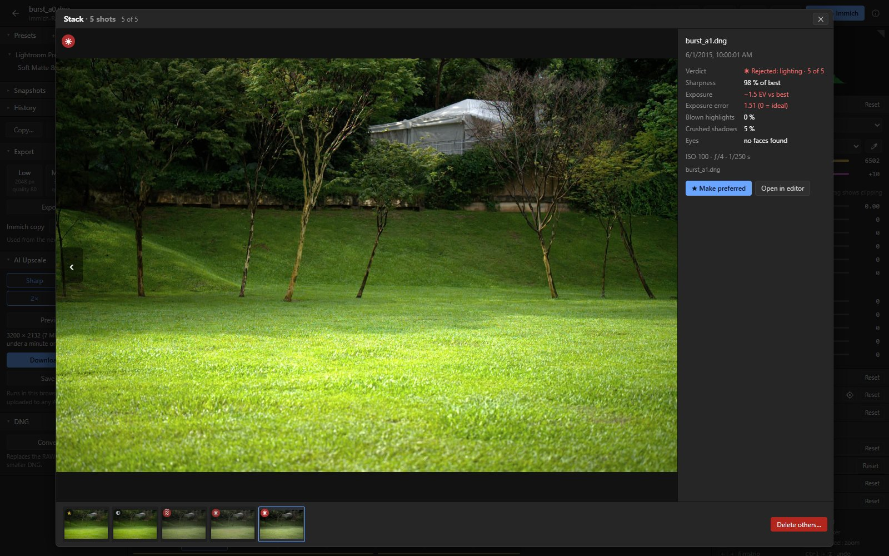
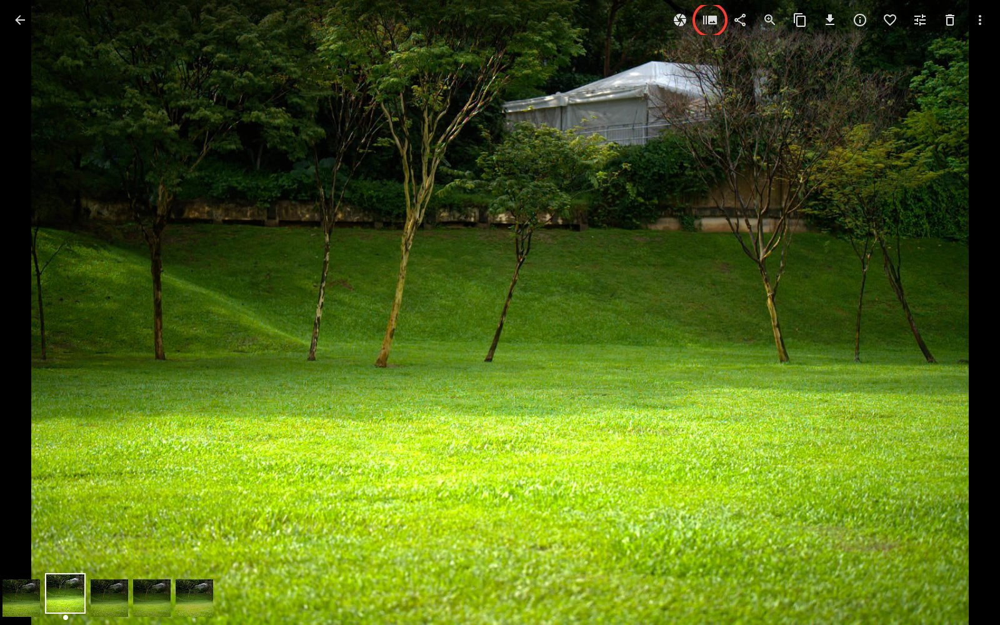

# Stacking and best pick

The optional culler sorts bursts and re-takes. It stacks photos of the same moment taken close
together, puts the best one in front, and tags the others with why they lost: lighting, blur or
closed eyes. Exposure brackets get a stack of their own and are kept whole, and near-ties are
marked as close calls. It works on RAWs, camera JPEGs and RAW + JPEG pairs, sorts new uploads by
itself, and you can run it on a day, an album or a selection, with a preview first and undo
afterwards.

Setting it up: [Installation → the culler](installation.md#optional-the-culler-auto-stack-and-best-pick).
To try it without your own photos, the [demo](../deploy/demo/README.md) has bursts ready. How it
decides, its settings and the command line: [docs/culler.md](culler.md).

## In the editor

The filmstrip groups each stack's RAWs, best first, with a coloured line under them.
- **Badges:** ★ best (★≈ when it's a close call: the next shot is nearly as good), ◐ runner-up,
  ± a shot of an exposure bracket, and a red badge for rejected shots: ☀ lighting, ≋ sharpness,
  ◉ eyes.
- **Tooltip:** the reason and the measurements, for example "−1.5 EV vs best", "sharpness 54 % of
  best (the bird)" or "bracket −2.0 EV".
- **Stack controls:** the number on a stack opens the stack window (below). ★ on another photo makes
  that one the best. **Collapse stacks** in the filmstrip's header shows only the best photo of each
  stack.
- **Title line:** shows the verdict for the photo you're editing, for example "★ best of 6",
  "★≈ best of 4 · close call", "± exposure bracket (2 of 3)" or "rejected: not sharp". Click it to
  open the stack window.

**Auto-stack…** in the filmstrip runs the culler on the album the editor was opened from, or else
on the day of the photo. **Preview** shows what it would do (a dry run), **Apply** does it, **Undo
last run** takes it back. Its checkboxes choose what the run takes into account; the browser
remembers them.
- **People's exposure counts most:** the faces, or else the people, before the rest of the photo.
- **Find people without a visible face.**
- **Prefer the most smiles.**
- **Set aside closed eyes** (also half-blinks).
- **Keep exposure brackets together:** a stack of their own, none of them set aside.
- **One stack per moment:** a new pose after a pause gets a stack of its own; a re-take of the same
  pose stays.

**Your picks** at the bottom of the panel shows up once you chose another best than the culler (★ on
another photo, or a shot put in front in Immich). It says how often, and suggests settings that would
have agreed with you. **Preview with this** shows what the suggestion would do to these photos, and
**Apply** then uses it for this run only. To keep it for every run, **Copy for culler.toml** and add
the lines to the culler's settings file ([Your picks](culler.md#your-picks)).

## From Immich's selection

Select two photos or more in Immich (in the timeline, an album or a person's page) and click
**Auto-stack** (a stack of photos with a star) in the selection bar. It opens a page for those
photos with the same checkboxes as **Auto-stack…** in the editor.

- **Preview** shows the result and changes nothing. Every stack is a row, with its preferred shot
  large and all its shots beside it. Single photos come between the stacks, all in the order taken.
- **Close calls** come first: a box above the rows lists the stacks whose best and next shot nearly
  tied, and a click on one shows its row.
- **−** on a shot takes it out of its stack, and it becomes a single photo.
- A click on a single photo offers the stack taken just before it and the one just after it, and
  adds it to the one you pick.
- On a preview these edits show in a new preview at once. **Stack and pick the best** then makes
  the stacks with them (it applies the preview on show, if it has the current choices).
- After stacking, each edit changes the stacks in Immich at once. A click on a stack opens it in
  the stack window, to check the pick or delete the others.
- The culler remembers the edits for later runs ([Your changes win](culler.md#your-changes-win)).
- **Undo** undoes the last change, then the one before it, down to the stacking itself. After a
  change in the stack window it is off (undo goes newest run first).
- **Photos taken out of stacks before** are left alone, and the summary says how many. **Include
  previously stacked pictures** (unchecked at first), or **Include them** in the summary, includes
  them; only stacking with it makes the culler forget that you took them apart.
- The button shows only when the culler works for you: on the same address as Immich, and run with
  your API key.

## The stack window

It shows the shots of one stack, best first, one at a time and large.
- **Opening it:** the number on a stack in the filmstrip, the verdict in the editor's title line, or
  **Compare stack** in Immich's photo viewer. That button shows on photos in a stack the culler made
  with at least two shots. It opens the window as a page of its own; Esc goes back to Immich.
- **Switching shots:** ← / →, Home / End, the thumbnails at the bottom, or a swipe on touch screens.
- **Details:** the verdict and its place in the stack, whether it's a close call, sharpness (and
  what it was measured on: the eyes, the animal or the sharpest areas) and exposure compared with the
  best shot, the faces' or people's own exposure, blown highlights, crushed shadows, the exposure
  error, how open the eyes are (in %), smiles, the people found, the camera settings and the files of
  the shot. The measurement a shot was rejected for is shown in red.
- **Exposure brackets** show each shot's exposure step from the one in front, by the camera settings
  and as measured.
- **Pictures:** each shot shows its edit if it has one, else the camera JPEG, else the RAW. Immich's
  RAW previews are auto-brightened, so for exposure trust the numbers more than the RAW's picture.
- **★ Make preferred** (or P) puts the shot in front, the same as ★ in the filmstrip.
- **Delete others…** keeps the preferred shot and moves every other shot to Immich's trash: its RAW,
  camera JPEG and edits. It asks first.
  - Files in the stack the culler doesn't know are left alone.
  - The culler then sorts the group again. With one shot left, it takes the stack apart, puts a RAW
    + JPEG pair back into its own stack and removes the `Culling/` tags.
  - To get the shots back, restore them from Immich's trash and run **Auto-stack…** again.
  - An exposure bracket has no **Delete others…**: its shots belong together.

The filmstrip shows only RAWs. Stacks of JPEGs are sorted too, and show in Immich.

## In Immich

The results are ordinary Immich stacks and tags, so they show everywhere in Immich and its apps.
The shots that lost get tags under `Culling/` (for example `Culling/Rejected/Blur`): search for
those to find them. `Culling/Close call` finds the stacks worth a look, and `Culling/Bracket` the
exposure brackets. New uploads are sorted by themselves once an upload batch has been quiet for 5
minutes ([docs/culler.md](culler.md#using-it)).

Saving an edit of a shot in such a stack keeps the best shot in front. The edited JPEG joins the
stack behind it and gets the RAW's tags, `Culling/` ones included, whichever photo Save is set to
put in front ([Getting started](getting-started.md#3-save)).
