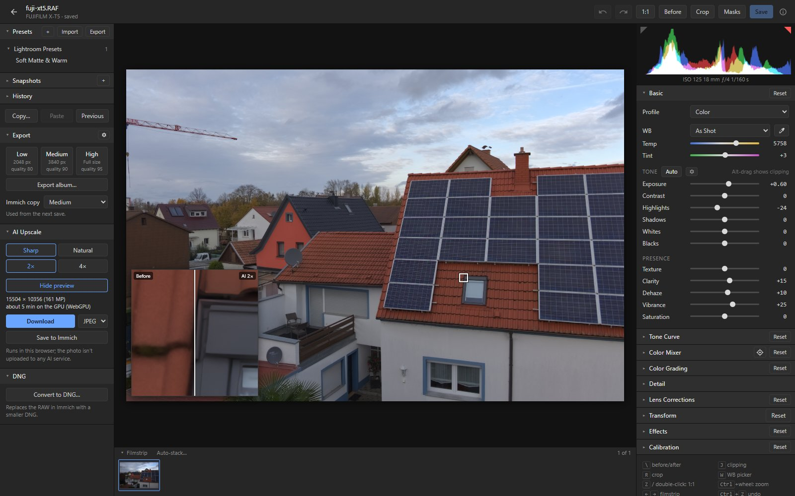
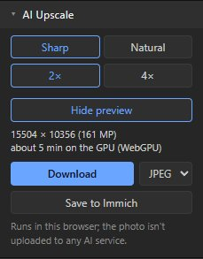

# AI Upscale

AI Upscale makes your edit, saved or not, 2× or 4× larger with an AI model that runs in the
browser: for big prints or tight crops. It is in the left panel.

## Using it

- **Preview a detail** puts a square on the photo. Drag it to a spot you care about, and the loupe
  shows that spot plainly enlarged on the left and AI-upscaled on the right. Drag across the loupe
  to move the divider.
- Pick **Sharp** (crisp edges, fast) or **Natural** (keeps fine texture, about 5× slower).
- **Download** gives a JPEG or TIFF. **Save to Immich** adds a JPEG to the RAW's stack, behind the
  photo in front; Immich's Edit button on that copy opens the RAW again. The RAW and your saved edit
  stay as they are.
- The panel shows the size of the result and roughly how long it will take. A running upscale can
  be cancelled.

## Limits

- **Speed:** with an integrated laptop GPU (Radeon 780M), 2× of a 45 MP photo took 5 minutes with
  Sharp; a dedicated graphics card is faster.
- **Size:** results go up to 200 MP (50 MP on phones and tablets), which covers 2× of photos up to
  50 MP. Crop larger photos first. A result needs about 4 bytes per pixel of browser memory, up to
  800 MB at 200 MP.
- **HTTPS:** whole photos need a graphics card the browser can use (WebGPU), so open the editor
  over HTTPS or on `localhost`. On plain HTTP the model gets one CPU thread, about 2 to 3 minutes
  per megapixel of photo. The preview works, and so do crops of a few megapixels (under 10
  minutes); whole photos are refused with a note saying why.

## How it works

The ONNX Runtime worker that runs the [AI masks](masks.md#how-ai-masks-work) runs one of two
super-resolution models:
- Real-ESRGAN general x4v3 (5 MB, BSD-3-Clause) for Sharp;
- RealPLKSR (30 MB, MIT), darktable's upscaler, for Natural.

The full-resolution render is cut into overlapping tiles. Each tile carries extra context that is
cut off again, and tiles blend into their neighbours, so no seams show. 2× from the 4×-only Sharp
model averages 2×2 blocks. The model is downloaded once, after asking, and the photo never leaves
the browser. Speeds and the model comparison:
[docs/spike-results.md](spike-results.md#ai-upscale-model-choice-2026-11-12).
