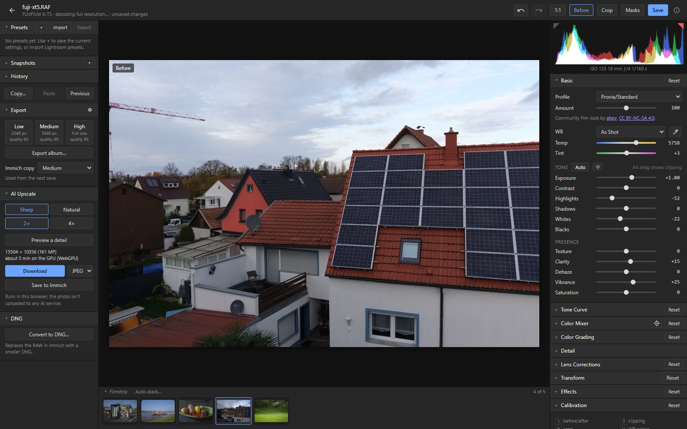
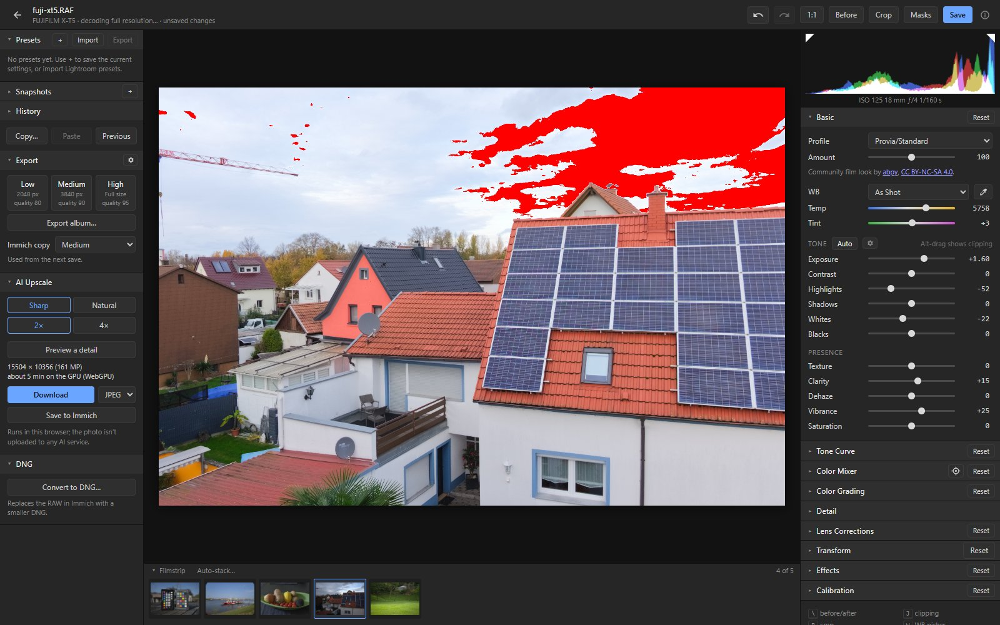
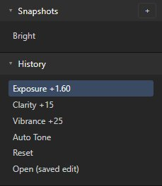
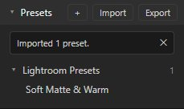
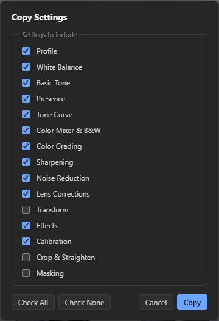
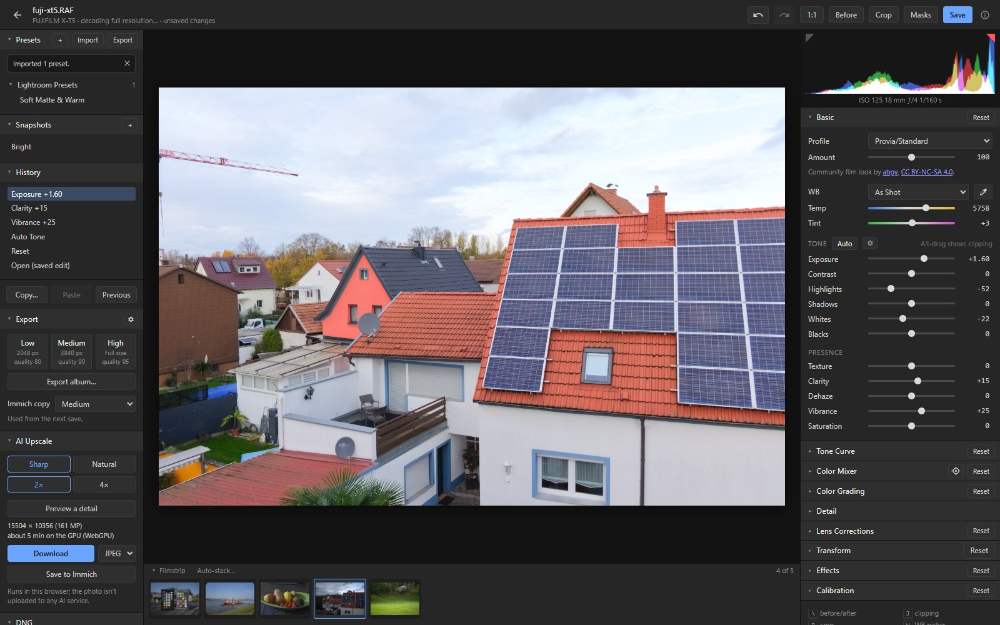
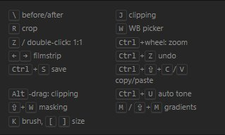

# Workflow

Tools around the edit: seeing it, going back, reusing it and moving between photos.

## Histogram, clipping, before/after and zoom

- **Histogram** at the top right, with the camera settings. J shows clipping in the photo (or
  click the triangles); Alt-dragging a tone slider shows what it clips.
- **Before/after:** `\` or **Before** in the header.
- **Zoom:** double-click the photo or Z for 100 %; Ctrl + mouse wheel, or pinch on a trackpad, for
  free zoom up to 800 %.

## History, snapshots and undo

- **History** lists every change with its name; click a step to go back to it. Ctrl+Z and
  Ctrl+Shift+Z (or the arrows in the header) undo and redo.
- **Snapshots** save the current settings under a name (+), stored on the RAW in Immich.

## Presets

**+** saves the current settings (or a part of them) as a preset; **Import** reads Lightroom
`.xmp` presets. Hover over a preset to preview it on the photo, click to apply it. Presets are kept
in the browser.

## Copy and paste

**Copy…** (Ctrl+Shift+C) picks which settings to copy; **Paste** (Ctrl+Shift+V) applies them to
another photo; **Previous** (Ctrl+Alt+V) applies the settings of the photo you edited before.

## Filmstrip

Below the photo: the RAWs of the album or person you opened the photo from, otherwise the RAWs
taken within 12 hours of it. ← and → go to the previous and next photo. With the culler it also
shows stacks ([Stacking](stacking.md)).

## Lightroom import

When a RAW is opened for the first time and Immich has a Lightroom XMP sidecar for it, the editor
offers to apply it: basic, curves, colour mixer, B&W, colour grading, calibration, detail, lens
corrections, transform, effects, crop and masks.
- AI masks (Subject, Sky, Background, People parts, Landscape) are found again in the photo.
- AI Objects and one person's parts can't be told apart in the file: objects are skipped, and a
  part of one person applies to everyone.
- Lightroom presets with AI masks (Adaptive presets) work the same.

## Keyboard shortcuts

On a computer, the editor lists its shortcuts at the bottom of the right-hand panel.

