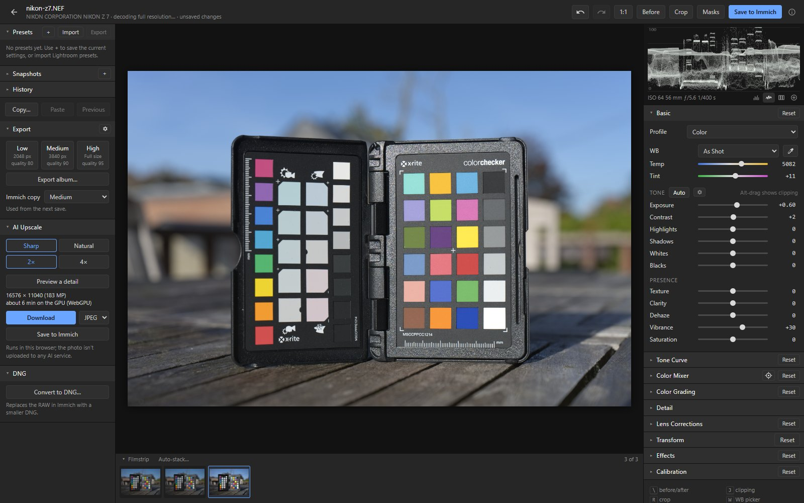
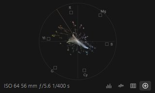
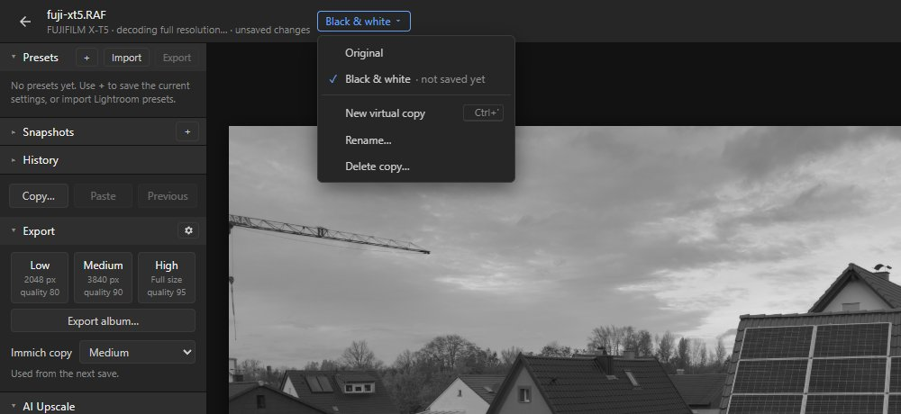

# Workflow

Tools around the edit: seeing it, going back, reusing it and moving between photos.

## Histogram and scopes, clipping, before/after and zoom

- **Histogram** at the top right, with the camera settings. J shows clipping in the photo (or
  click the triangles); Alt-dragging a tone slider shows what it clips.
- **Scopes:** the buttons under the histogram switch it to
  - a **waveform**: the brightness of the photo from left to right, black at the bottom;
  - an **RGB parade**: the same for red, green and blue side by side;
  - a **vectorscope**: hue and saturation, with the 75 % colour targets and the skin tone line.

  The choice is kept in the browser.
- **Before/after:** `\` or **Before** in the header.
- **Zoom:** double-click the photo or Z for 100 %; Ctrl + mouse wheel, or pinch on a trackpad, for
  free zoom up to 800 %.

## History, snapshots and undo

- **History** lists every change with its name; click a step to go back to it. Ctrl+Z and
  Ctrl+Shift+Z (or the arrows in the header) undo and redo.
- **Snapshots** save the current settings under a name (+), stored on the RAW in Immich.

## Drafts

Unsaved changes are kept in this browser as a draft, one per photo and per virtual copy, so going
to another photo, another copy or back to Immich never asks.
- **When:** a moment after you stop editing, and whenever you leave the photo.
- **Opening a photo with a draft** opens the draft: the title line says "unsaved changes", and the
  filmstrip marks the photo with a blue dot. One undo step goes back to the saved edit; within one
  visit to the editor, each photo keeps its whole undo history.
- **Save** stores it in Immich as usual, and the draft goes. **Discard** in the title line goes back
  to the saved edit (or the photo's defaults).
- **Save N drafts**, in the filmstrip's header, saves the drafts of the photos in the filmstrip,
  one photo after another, like a Save of each (a full-resolution render with the Immich copy's
  preset). The editor waits meanwhile; Cancel stops after the photo being saved.
- **Only in this browser** (its IndexedDB): another browser or device doesn't see the draft. If the
  photo was saved somewhere else after the draft was made, a banner asks whether to keep the draft
  or use the saved edit.
- The browser only asks before closing the tab while a save is running, or right after an edit,
  before its draft is written.

## Virtual copies

Several edits of one RAW, like Lightroom's virtual copies: a colour and a black-and-white version,
say, or two crops.
- **New virtual copy** (Ctrl+'), in the menu next to the file name, starts a copy from the current
  settings and opens it. Unsaved changes go with it; the edit it was made from keeps its saved
  state.
- Each copy saves its own JPEG into the RAW's stack, called `<name>.copy-2.edit.jpg`. The
  original's JPEG stays in front; **Show in front in Immich** puts the open edit's JPEG there
  instead.
- The menu switches between the original and the copies (each keeps its unsaved changes as a
  [draft](#drafts)),
  renames the open copy or deletes it, with its JPEG going to Immich's trash. Each copy has its
  own history and snapshots.
- Immich's Edit RAW button on a copy's JPEG opens that copy. An album export includes each copy
  whose JPEG is in the album, named `<name>-copy-2`.

## Presets

**+** saves the current settings (or a part of them) as a preset; **Import** reads Lightroom
`.xmp` presets. Hover over a preset to preview it on the photo, click to apply it. Presets are kept
in the browser.

## Copy and paste

**Copy…** (Ctrl+Shift+C) picks which settings to copy; **Paste** (Ctrl+Shift+V) applies them to
another photo; **Previous** (Ctrl+Alt+V) applies the settings of the photo you edited before.

## Filmstrip

Below the photo: the RAWs of the album or person you opened the photo from, otherwise the RAWs
taken within 12 hours of it. ← and → go to the previous and next photo, ↑ and ↓ to the previous
and next stack (past the rest of the open photo's stack) or single photo. With the culler it also
shows stacks ([Stacking](stacking.md)).

Each thumbnail shows the photo as edited: its draft's picture, else its saved JPEG, else the RAW.
Along its bottom: ✕ rejected, ♥ picked, its stars, ● a draft or ✎ a saved edit. Drag the strip's
top edge to make the thumbnails bigger.

**Stars, pick and reject** go on the open photo with the keys, also while it is still opening:
- 0 to 5: its stars in Immich (0 takes them off).
- P: pick, which is Immich's favourite; a reject goes.
- X: reject, with the tag `Culling/Rejected` (under the culler's tag root, if it has another one).
  It also takes the favourite off, and sets Immich's reject flag on a photo without stars. In the
  crop tool X still turns the crop.
- U: neither picked nor rejected; it also takes the culler's reject tags off, and the culler leaves
  the photo a runner-up from then on ([Culler → Your changes win](culler.md#your-changes-win)).

They go on the whole shot: the RAW, its camera JPEG and its edits, so Immich shows them whichever
file is in front of the stack.

**Several photos at once:** Ctrl-click (⌘-click on a Mac) adds a photo to the selection (the open
photo comes along), Shift-click selects everything from the last photo clicked; on a phone, a long
press starts selecting and taps add or remove photos. A click alone, or Esc, selects none again.
- 0-5, P, X and U then go on every selected photo.
- **Sync settings…** puts settings of the open photo on the other selected photos, with the same
  choice of groups as Copy Settings. Each gets a [draft](#drafts) with just those settings; they go
  on top of whatever the photo has when it opens or is saved (its saved edit, or its own starting
  settings, such as a Fujifilm RAW's film look). **Save N drafts** then saves the selected photos'
  drafts to Immich.

**Filters** in the filmstrip's header: at least so many stars, only picks (♥), no rejects (✕), and
edited, not edited or with a draft. The photos they leave out are skipped by ← → ↑ ↓; the open photo
always stays. The filmstrip remembers them.

The next photo opens in the same page, without loading the editor again, and the address bar
follows: the browser's Back and Forward go through the photos you opened. Unsaved changes stay
as a [draft](#drafts).

It shows at once, as it looked in the editor last time (or as its saved JPEG, or Immich's
preview), until it can be edited: the filmstrip gets that picture ready for the photos on either
side and for the rest of the open photo's stack. ← and → (and Esc) work while a photo is still
opening, so you can flip through a stack without waiting for each photo.

Over HTTPS the editor gets the photos around the open one ready while you edit: the next and
previous photo, then the two after those. It downloads them as soon as the open photo shows, and
decodes them once the open photo is decoded at full resolution. Then ← and → open them from the
browser's cache (800 MB, shared with the photos opened before; photos that don't fit are left
out). It doesn't do this with Data Saver on, on a mobile network, or on a device with less than
4 GB of memory.

## Lightroom import

When a RAW is opened for the first time and Immich has a Lightroom XMP sidecar for it, the editor
offers to apply it: basic, curves, colour mixer, B&W, colour grading, calibration, detail, lens
corrections, transform, effects, crop and masks.
- AI masks (Subject, Sky, Background, People parts, Landscape) are found again in the photo.
- AI Objects and one person's parts can't be told apart in the file: objects are skipped, and a
  part of one person applies to everyone.
- Lightroom presets with AI masks (Adaptive presets) work the same.

## Keyboard shortcuts

On a computer, the editor lists its shortcuts at the bottom of the right-hand panel.

